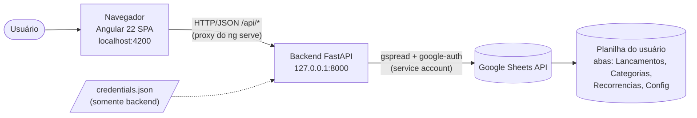
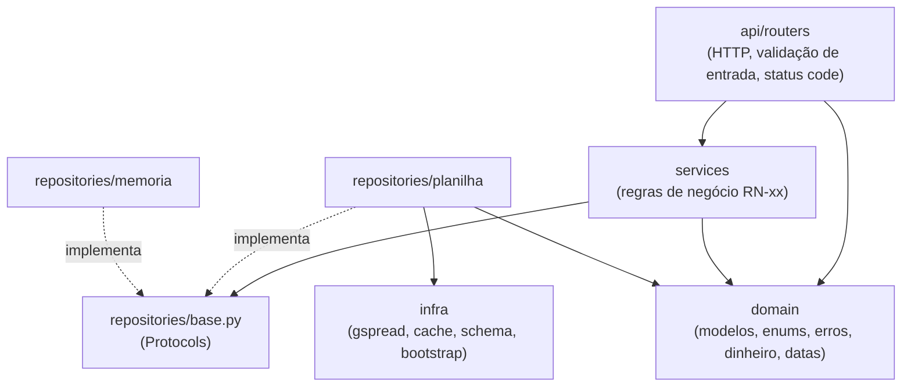
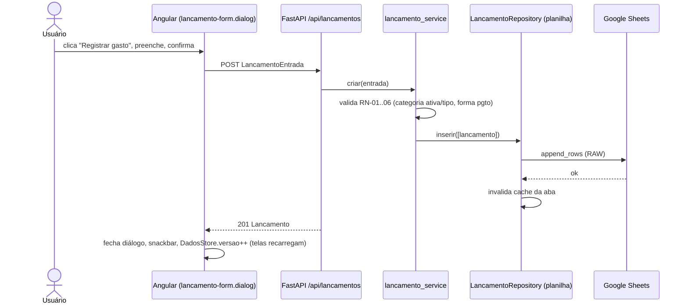
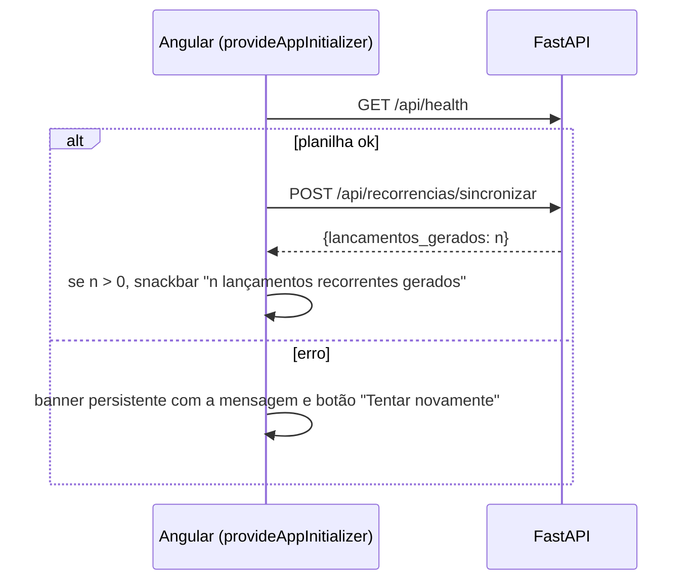

# 03 — Arquitetura

| Campo | Valor |
|---|---|
| Documento | `SPECS/03-arquitetura.md` |
| Versão | 1.4 |
| Atualizado em | 2026-09-29 |
| Status | Aprovado para início |
| Responde | **Como** o sistema se organiza: componentes, pastas, camadas, modelo de dados na planilha, contrato da API e fluxos |
| Depende de | `01-requisitos.md`, `02-definicoes-tecnicas.md` |
| Alimenta | `04-roadmap.md`, `features/F-xx-*.md`, todo o código |

> **Regra para IA:** respeite as regras de dependência entre camadas (§4.2) e o contrato da API (§6). Qualquer endpoint, coluna de planilha ou pasta nova precisa ser acrescentado **aqui** na mesma tarefa em que for criado.

---

## 1. Visão geral



- O navegador **nunca** fala com o Google; só com o backend.
- O backend é **sem estado persistente próprio**: a planilha é a fonte da verdade (RN-14); o backend mantém apenas cache em memória.
- Tudo roda na máquina do usuário.

---

## 2. Princípios

1. **Planilha como banco, backend como guardião das regras.** Toda regra de negócio (RN-xx) vive nos *services* do backend.
2. **Camada de acesso substituível.** Services dependem de interfaces de repositório; há uma implementação em planilha e outra em memória (testes).
3. **Localizar por `id`, nunca por posição guardada.** Linhas podem mudar de lugar por edição manual.
4. **Esquema declarado em um só lugar.** Abas e colunas são definidas em `backend/app/infra/schema_planilha.py`; bootstrap, leitura e escrita derivam dele.
5. **Frontend fino.** Exibe, valida formulário e chama a API; não calcula totais nem aplica regras de negócio.

---

## 3. Estrutura do repositório

```text
PlanilhaFinanceira/
├── CLAUDE.md                      # contexto permanente para o Claude Code
├── credentials.json               # chave da service account — NUNCA versionar
├── .gitignore
├── .claude/
│   ├── settings.json              # permissões (bloqueia leitura de credenciais)
│   └── commands/                  # comandos /proxima-tarefa, /implementar-tarefa ...
├── SPECS/                         # specs (fonte da verdade do projeto)
├── scripts/                       # start-backend.ps1, start-frontend.ps1, start.ps1
├── backend/
│   ├── .env.example
│   ├── requirements.txt / requirements-dev.txt
│   ├── pyproject.toml             # config de ruff e pytest
│   ├── app/
│   │   ├── main.py                # cria o app, CORS, handlers de erro, lifespan (bootstrap)
│   │   ├── config.py              # Settings (pydantic-settings)
│   │   ├── api/
│   │   │   ├── deps.py            # injeção de repositórios/serviços (Depends)
│   │   │   ├── erros.py           # exception handlers → formato padrão (§6.2)
│   │   │   ├── schemas.py         # DTOs de entrada/saída da API
│   │   │   └── routers/           # health, sistema, formas_pagamento, categorias,
│   │   │                          # lancamentos, parcelamentos, recorrencias, resumo
│   │   ├── domain/
│   │   │   ├── modelos.py         # Lancamento, Categoria, Recorrencia
│   │   │   ├── enums.py           # TipoLancamento, FormaPagamento, StatusRecorrencia
│   │   │   ├── erros.py           # exceções de domínio
│   │   │   ├── dinheiro.py        # tipo Dinheiro, divisão em parcelas
│   │   │   └── datas.py           # somar_meses, ajustar_dia, mes_referencia
│   │   ├── services/              # categoria, lancamento, parcelamento, recorrencia, resumo
│   │   ├── repositories/
│   │   │   ├── base.py            # Protocols dos repositórios
│   │   │   ├── memoria/           # implementações em memória (testes)
│   │   │   └── planilha/          # implementações gspread
│   │   └── infra/
│   │       ├── sheets_client.py   # autenticação, abertura, retry/backoff, mapeamento de
│       │                   # erros e `ConexaoPlanilha` (estado + nova tentativa)
│   │       ├── schema_planilha.py # abas e colunas (fonte única)
│   │       ├── bootstrap.py       # cria abas/cabeçalhos/seed de forma idempotente
│   │       └── cache.py           # cache por aba com TTL
│   └── tests/
│       ├── conftest.py
│       ├── unit/  api/  integracao/
└── frontend/
    ├── proxy.conf.json
    └── src/app/
        ├── app.config.ts  app.routes.ts  app.ts (classe `App`)  # shell
        ├── core/
        │   ├── models/        # interfaces espelhando o JSON da API
        │   ├── api/           # um serviço HTTP por recurso
        │   ├── state/         # mes-selecionado.store.ts, categorias.store.ts, dados.store.ts
        │   ├── interceptors/  # erro.interceptor.ts
        │   └── utils/         # mes.ts (YYYY-MM), formatação
        ├── shared/
        │   ├── components/    # seletor-mes, confirmacao-dialog, estado-vazio, carregando
        │   └── grafico/       # grafico.directive.ts + grafico.config.ts (Chart.js, ADR-11)
        └── features/
            ├── resumo/        # dashboard do mês (cards + gráficos)
            ├── lancamentos/   # listagem + lancamento-form.dialog
            ├── historico/
            ├── categorias/
            └── recorrencias/
```

---

> **Nomes de arquivo (frontend):** style guide **2025** do Angular, padrão do CLI 22 — componentes sem sufixo `.component` (`app.ts`, classe `App`). Os sufixos que descrevem papel continuam: `*.store.ts`, `*.interceptor.ts`, `*.directive.ts`, `*.config.ts`, `*.dialog.ts` (ADR-13).

---

## 4. Backend

### 4.1 Camadas



### 4.2 Regras de dependência (obrigatórias)

| Módulo | Pode importar | Não pode importar |
|---|---|---|
| `domain` | apenas biblioteca padrão e pydantic | qualquer outro módulo do app |
| `services` | `domain`, `repositories.base` | `fastapi`, `gspread`, `infra`, `repositories.planilha` |
| `repositories.planilha` | `domain`, `infra` | `services`, `api` |
| `infra` | `domain`, `gspread`, `google-auth` | `services`, `api` |
| `api` | `domain`, `services`, `repositories.base`, `api.deps` | `gspread`, `infra` (exceto em `deps.py`/`main.py`) |

Somente `api/deps.py` e `main.py` conhecem as implementações concretas (composição).

### 4.3 Repositórios

```python
class LancamentoRepository(Protocol):
    def listar(self) -> ListagemComAvisos[Lancamento]: ...   # todas as linhas válidas + nº de linhas ignoradas
    def obter(self, id: str) -> Lancamento: ...              # NaoEncontrado
    def inserir(self, itens: list[Lancamento]) -> None: ...  # sempre em lote
    def atualizar(self, item: Lancamento) -> None: ...
    def remover(self, ids: list[str]) -> None: ...
```
`CategoriaRepository` e `RecorrenciaRepository` seguem o mesmo formato. Filtros por mês, tipo etc. são feitos no *service* sobre `listar()` (volume pessoal; leitura única por aba — ver `02` §5.5).

### 4.4 Serviços e responsabilidades

| Service | Responsabilidades | Regras |
|---|---|---|
| `categoria_service` | CRUD, geração de slug, unicidade, bloqueio de exclusão em uso, seed padrão | RN-12, RN-15 |
| `lancamento_service` | criar/editar/excluir, validar categoria ativa e do mesmo tipo, forma de pagamento, listar por mês com filtros e totais | RN-01..06, RN-13 |
| `parcelamento_service` | dividir valor, calcular datas, criar lote, excluir parcelamento | RN-07, RN-08 |
| `recorrencia_service` | CRUD, mudança de status, sincronização idempotente por marca d'água `ultimo_mes_gerado` | RN-09..11 |
| `resumo_service` | resumo mensal, histórico, agregações em `Decimal` | RN-13, RN-16 |

**Algoritmo de sincronização de recorrências** (REQ-10):
```text
para cada recorrência com status ATIVA:
    primeiro = max(mes_inicio, proximo_mes(ultimo_mes_gerado))   # se ultimo_mes_gerado vazio → mes_inicio
    ultimo   = min(mes_corrente, mes_fim or mes_corrente)
    para cada mes em [primeiro .. ultimo]:
        gerar lançamento com data = ajustar_dia(mes, dia_do_mes), recorrencia_id = id
    ultimo_mes_gerado = ultimo  (se gerou algo)
inserir todos os lançamentos gerados em UMA chamada; depois atualizar as recorrências
```
Ao **reativar** uma recorrência pausada: `ultimo_mes_gerado = max(ultimo_mes_gerado, mes_anterior(mes_corrente))` (RN-11 — sem retroativos).

### 4.5 Inicialização (lifespan)

1. Carregar `Settings`; validar existência do arquivo de credenciais.
2. Conectar e abrir a planilha por ID. Falha **não derruba** o servidor: o erro é guardado e `GET /api/health` o reporta (REQ-16); demais endpoints respondem 503.
3. `bootstrap`: para cada aba do schema, criar se não existir e escrever cabeçalho; se existir, validar cabeçalho (colunas faltando no fim são acrescentadas; divergência de ordem → erro claro). Aba `Categorias` vazia → seed RN-15. Idempotente (CA-15.2).

---

## 5. Modelo de dados na planilha

Uma aba por entidade; **linha 1 = cabeçalho** (nomes exatamente como abaixo); uma linha por registro. Colunas novas só podem ser **acrescentadas no final**.

### 5.1 Aba `Lancamentos`

| Col | Campo | Tipo na planilha | Obrigatório | Exemplo |
|---|---|---|---|---|
| A | `id` | texto (uuid hex) | sim | `9f1c...` |
| B | `data` | texto ISO | sim | `2026-09-29` |
| C | `tipo` | texto `GASTO`/`RECEITA` | sim | `GASTO` |
| D | `descricao` | texto | sim | `Almoço` |
| E | `valor` | número (> 0, 2 casas) | sim | `42.5` |
| F | `categoria_id` | texto (slug) | sim | `alimentacao` |
| G | `forma_pagamento` | texto enum | se GASTO | `PIX` |
| H | `observacao` | texto | não | |
| I | `parcelamento_id` | texto | não | `a71b...` |
| J | `parcela_numero` | número | se parcelado | `3` |
| K | `parcela_total` | número | se parcelado | `10` |
| L | `recorrencia_id` | texto | não | `c02d...` |
| M | `criado_em` | texto ISO datetime | sim | `2026-09-29T10:15:00` |
| N | `atualizado_em` | texto ISO datetime | sim | |

### 5.2 Aba `Categorias`

| Col | Campo | Tipo | Observação |
|---|---|---|---|
| A | `id` | texto (slug) | Imutável; gerado do nome na criação (minúsculas, sem acento, `-` como separador; sufixo `-2`, `-3` em colisão). |
| B | `nome` | texto | Exibido na interface; pode ser renomeado. |
| C | `tipo` | `GASTO`/`RECEITA` | |
| D | `cor` | texto `#RRGGBB` | Usada nos gráficos. |
| E | `ativa` | booleano | |
| F | `criado_em` | texto ISO datetime | |

### 5.3 Aba `Recorrencias`

| Col | Campo | Tipo | Observação |
|---|---|---|---|
| A | `id` | texto | |
| B | `tipo` | `GASTO`/`RECEITA` | |
| C | `descricao` | texto | |
| D | `valor` | número | |
| E | `categoria_id` | texto | |
| F | `forma_pagamento` | texto enum | se GASTO |
| G | `dia_do_mes` | número 1–31 | |
| H | `mes_inicio` | texto `YYYY-MM` | |
| I | `mes_fim` | texto `YYYY-MM` | vazio = sem fim |
| J | `status` | `ATIVA`/`PAUSADA`/`ENCERRADA` | |
| K | `ultimo_mes_gerado` | texto `YYYY-MM` | marca d'água (RN-10) |
| L | `criado_em` | texto ISO datetime | |
| M | `atualizado_em` | texto ISO datetime | |

### 5.4 Aba `Config`

| Col | Campo | Exemplo |
|---|---|---|
| A | `chave` | `versao_schema` |
| B | `valor` | `1` |

`versao_schema` permite migrações futuras. Mudou o schema? Incremente e descreva a migração em `bootstrap.py` e aqui.

### 5.5 Enums

| Enum | Valores (código → rótulo) |
|---|---|
| `TipoLancamento` | `GASTO` → Gasto, `RECEITA` → Receita |
| `FormaPagamento` | `PIX` → Pix, `CREDITO` → Cartão de crédito, `DEBITO` → Cartão de débito, `DINHEIRO` → Dinheiro, `BOLETO` → Boleto, `TRANSFERENCIA` → Transferência |
| `StatusRecorrencia` | `ATIVA`, `PAUSADA`, `ENCERRADA` |

### 5.6 Validação de linhas lidas

Linha com `id` vazio, data inválida, valor não numérico/≤ 0, tipo ou enum desconhecido → **ignorada** e contada em `linhas_ignoradas` (CA-16.3), com log `WARNING` indicando aba e número da linha.

---

## 6. Contrato da API

Base: `/api`. JSON em `snake_case`. Valores monetários como número com 2 casas. OpenAPI gerada em `http://127.0.0.1:8000/docs` deve refletir exatamente esta seção.

### 6.1 Endpoints

| Método | Caminho | Entrada | Saída | REQ |
|---|---|---|---|---|
| GET | `/api/health` | — | `200 {status, planilha: {ok, titulo, erro?}}` | REQ-16 |
| POST | `/api/sistema/recarregar` | — | `204` (invalida cache) | RN-14 |
| GET | `/api/formas-pagamento` | — | `200 [{codigo, nome}]` | REQ-01 |
| GET | `/api/categorias` | `?tipo=&incluir_inativas=` | `200 [Categoria]` | REQ-11 |
| POST | `/api/categorias` | `{nome, tipo, cor}` | `201 Categoria` · `409 CATEGORIA_DUPLICADA` | REQ-11 |
| PUT | `/api/categorias/{id}` | `{nome, cor, ativa}` | `200 Categoria` · `409` | REQ-11 |
| DELETE | `/api/categorias/{id}` | — | `204` · `409 CATEGORIA_EM_USO` | REQ-11 |
| GET | `/api/lancamentos` | `?mes=YYYY-MM` (obrig.) `&tipo=&categoria_id=&forma_pagamento=` | `200 ListaLancamentos` | REQ-03, REQ-04 |
| POST | `/api/lancamentos` | `LancamentoEntrada` | `201 Lancamento` | REQ-01, REQ-02 |
| PUT | `/api/lancamentos/{id}` | `LancamentoEntrada` | `200 Lancamento` · `404` | REQ-05 |
| DELETE | `/api/lancamentos/{id}` | — | `204` · `404` | REQ-06 |
| POST | `/api/parcelamentos` | `ParcelamentoEntrada` | `201 {parcelamento_id, lancamentos: [Lancamento]}` | REQ-07 |
| DELETE | `/api/parcelamentos/{parcelamento_id}` | — | `204` · `404` | REQ-08 |
| GET | `/api/recorrencias` | — | `200 [Recorrencia]` | REQ-09 |
| POST | `/api/recorrencias` | `RecorrenciaEntrada` | `201 Recorrencia` | REQ-09 |
| PUT | `/api/recorrencias/{id}` | `RecorrenciaEntrada` | `200 Recorrencia` | REQ-09 |
| PATCH | `/api/recorrencias/{id}/status` | `{status}` | `200 Recorrencia` | REQ-09 |
| POST | `/api/recorrencias/sincronizar` | — | `200 {lancamentos_gerados, detalhes: [{recorrencia_id, meses: [YYYY-MM]}]}` | REQ-10 |
| GET | `/api/resumo/mensal` | `?mes=YYYY-MM` | `200 ResumoMensal` | REQ-12, REQ-13 |
| GET | `/api/resumo/historico` | `?inicio=YYYY-MM&fim=YYYY-MM` (padrão: últimos 12) | `200 ResumoHistorico` | REQ-14 |

### 6.2 Formato de erro (todas as respostas ≥ 400)

```json
{
  "erro": {
    "codigo": "VALIDACAO",
    "mensagem": "Valor deve ser maior que zero.",
    "detalhes": [{ "campo": "valor", "mensagem": "deve ser maior que zero" }]
  }
}
```

| HTTP | `codigo` | Quando |
|---|---|---|
| 422 | `VALIDACAO` | Entrada inválida (inclui erros do Pydantic, convertidos para este formato) |
| 404 | `NAO_ENCONTRADO` | `id` inexistente |
| 409 | `CATEGORIA_DUPLICADA`, `CATEGORIA_EM_USO`, `CATEGORIA_INATIVA`, `CATEGORIA_TIPO_INCOMPATIVEL` | Conflitos de regra |
| 503 | `PLANILHA_INDISPONIVEL`, `SEM_PERMISSAO_PLANILHA`, `PLANILHA_NAO_ENCONTRADA`, `CREDENCIAIS_INVALIDAS`, `API_SHEETS_DESABILITADA` | Falhas no Google (ver `02` §5.6) |
| 500 | `ERRO_INTERNO` | Não previsto (mensagem genérica; detalhe só no log) |

Erros do próprio framework também saem neste envelope: rota inexistente vira 404 `NAO_ENCONTRADO` e os demais `HTTPException` viram `ERRO_INTERNO` com o status original — assim o `erro.interceptor.ts` (§8.4) tem uma única forma para interpretar. O handler é registrado para a `HTTPException` do **Starlette**, classe-mãe da do FastAPI, porque o 404 de roteamento levanta a mãe.

### 6.3 Esquemas principais

```jsonc
// Health (GET /api/health) — sempre HTTP 200, para o frontend distinguir
// "backend fora" de "planilha com problema" (banner em §7.2)
{ "status": "ok",          // "ok" quando a planilha responde, "degradado" quando não
  "planilha": { "ok": true, "titulo": "Planilha Financeira", "erro": null } }
// degradado: planilha.ok = false, titulo = null,
//            erro = { codigo, mensagem } com um dos códigos 503 de §6.2
```

```jsonc
// LancamentoEntrada
{ "data": "2026-09-29", "tipo": "GASTO", "descricao": "Almoço", "valor": 42.50,
  "categoria_id": "alimentacao", "forma_pagamento": "PIX", "observacao": null }

// Lancamento = LancamentoEntrada +
{ "id": "9f1c...", "categoria_nome": "Alimentação", "categoria_cor": "#E57373",
  "parcelamento_id": null, "parcela_numero": null, "parcela_total": null,
  "recorrencia_id": null, "criado_em": "...", "atualizado_em": "..." }

// ListaLancamentos
{ "mes": "2026-09", "itens": [Lancamento],
  "totais": { "gastos": 1234.56, "receitas": 5000.00, "saldo": 3765.44 },
  "linhas_ignoradas": 0 }

// ParcelamentoEntrada
{ "data": "2026-01-15", "descricao": "Geladeira", "valor_total": 1000.00, "parcelas": 3,
  "categoria_id": "moradia", "forma_pagamento": "CREDITO", "observacao": null }

// RecorrenciaEntrada
{ "tipo": "GASTO", "descricao": "Streaming", "valor": 39.90, "categoria_id": "assinaturas",
  "forma_pagamento": "CREDITO", "dia_do_mes": 10, "mes_inicio": "2026-07", "mes_fim": null }

// Recorrencia = RecorrenciaEntrada + { "id", "status", "ultimo_mes_gerado", "proximo_mes", "criado_em", "atualizado_em" }

// ResumoMensal
{ "mes": "2026-09", "total_gastos": 0, "total_receitas": 0, "saldo": 0,
  "por_categoria": [{ "categoria_id", "nome", "cor", "total", "percentual" }],
  "por_forma_pagamento": [{ "forma_pagamento", "nome", "total", "percentual" }],
  "gasto_acumulado_diario": [{ "dia": 1, "total": 0 }],
  "linhas_ignoradas": 0 }

// ResumoHistorico
{ "inicio": "2025-10", "fim": "2026-09",
  "meses": [{ "mes": "2025-10", "total_gastos": 0, "total_receitas": 0, "saldo": 0 }],
  "por_categoria": [{ "categoria_id", "nome", "cor", "valores": [0, 0, ...] }],   // um valor por mês, na ordem de "meses"
  "total_gastos_periodo": 0, "media_mensal_gastos": 0 }
```
`percentual` é número de 0 a 100 com 1 casa. `por_categoria` e `por_forma_pagamento` consideram só gastos e vêm ordenados do maior para o menor.

---

## 7. Fluxos principais

### 7.1 Registrar gasto (REQ-01)



### 7.2 Abertura do aplicativo (REQ-10, REQ-16)


Falha no inicializador **não impede** o app de abrir.

---

## 8. Frontend

### 8.1 Rotas

| Rota | Página | REQ |
|---|---|---|
| `/` | redireciona para `/resumo` | |
| `/resumo?mes=YYYY-MM` | Resumo do mês: cards de totais + gráficos | REQ-12, REQ-13 |
| `/lancamentos?mes=YYYY-MM` | Listagem com filtros, editar/excluir | REQ-03..06, REQ-08 |
| `/historico?inicio=&fim=` | Histórico | REQ-14 |
| `/categorias` | Gestão de categorias | REQ-11 |
| `/recorrencias` | Gestão de recorrências | REQ-09 |

O **shell** (`app.ts`, classe `App`) tem barra superior com os botões **"Registrar gasto"** (primário) e "Registrar receita", navegação lateral e banner de erro de conexão.

### 8.2 Estado

| Store (`core/state/`) | Conteúdo | Observação |
|---|---|---|
| `MesSelecionadoStore` | `signal<string>` `YYYY-MM` | Sincronizado com o query param `mes` (REQ-04) |
| `CategoriasStore` | lista de categorias carregada uma vez; recarrega após alterações | Usado pelos formulários |
| `DadosStore` | `versao = signal(0)` incrementada após qualquer escrita | Páginas reagem e recarregam dados |
| `ConexaoStore` | estado do `health` e mensagem de erro | Alimenta o banner |

A aplicação é **zoneless**: toda mudança de estado que deve refletir na tela passa por um signal. Não usar APIs marcadas como *experimental* ou *developer preview* na v22 (ex.: Signal Forms) — ver `02` §4.

### 8.2.1 Gráficos

Todos os gráficos usam a `GraficoDirective` de `shared/grafico/` sobre um `<canvas>`. As páginas só montam `ChartData` a partir das respostas da API (cores vindas de `categoria_cor`/`cor`), sem calcular totais.

### 8.3 Formulário de lançamento

Um único componente `lancamento-form.dialog` atende: novo gasto, nova receita, edição e compra parcelada (checkbox "Compra parcelada" + nº de parcelas, visível só para gasto novo; envia para `/api/parcelamentos`). Em erro da API o diálogo permanece aberto com os dados (CA-01.4).

### 8.4 Tratamento de erros

`erro.interceptor.ts` converte respostas no formato §6.2 em `ErroApi` tipado; erros 503 atualizam o `ConexaoStore`; demais exibem snackbar com `mensagem`. Erros de validação (422) são entregues ao formulário para marcar campos (`detalhes[].campo`).

---

## Histórico de alterações

| Data | Versão | Alteração |
|---|---|---|
| 2026-09-29 | 1.0 | Versão inicial. |
| 2026-09-29 | 1.2 | §3 e §8: componente raiz passa a `app.ts` (classe `App`), style guide 2025 do Angular / padrão do CLI 22 (ADR-13, decidido em T-003). |
| 2026-09-29 | 1.3 | §6.2: código `API_SHEETS_DESABILITADA`. §6.3: esquema do `GET /api/health` (sempre 200, `status` `ok`/`degradado`) — ambos decididos em F-02. |
| 2026-09-29 | 1.4 | §6.2: erros do framework passam pelo mesmo envelope. §3: `ConexaoPlanilha` em `sheets_client.py` (T-005). |
| 2026-09-29 | 1.1 | Frontend em Angular 22 (zoneless); pasta `shared/grafico/` com diretiva Chart.js própria (§3, §8.2.1). |
