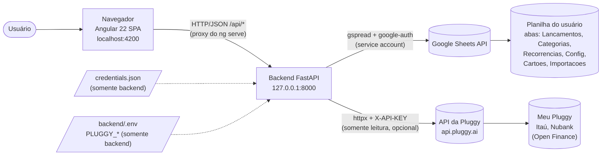
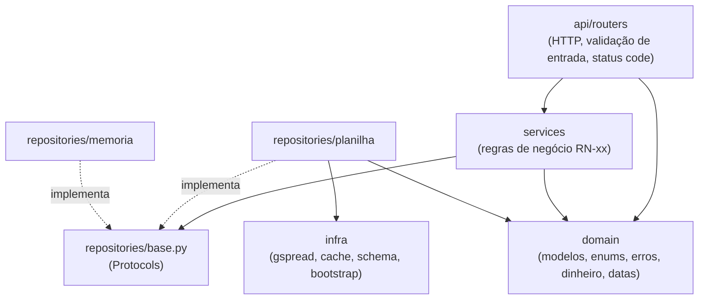
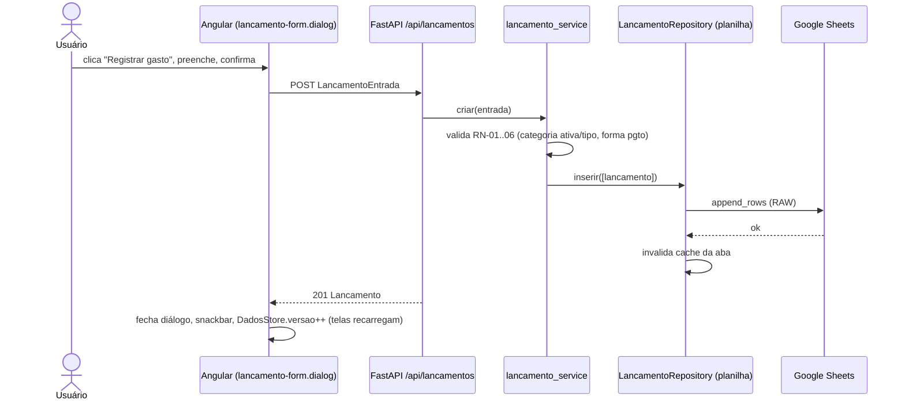
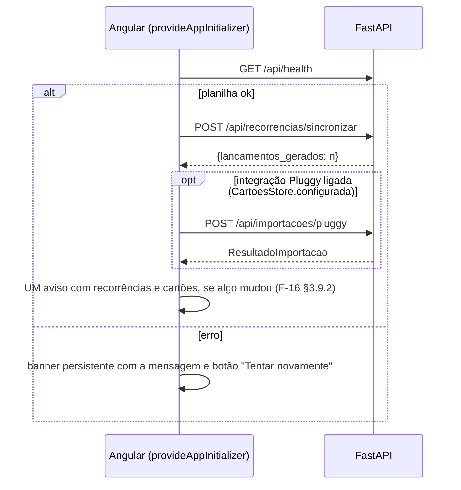
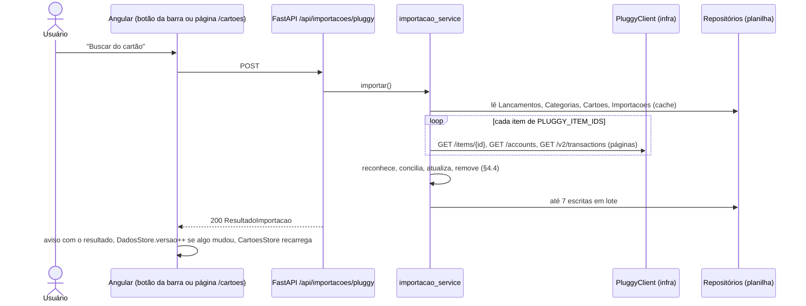

# 03 — Arquitetura

| Campo | Valor |
|---|---|
| Documento | `SPECS/03-arquitetura.md` |
| Versão | 1.38 |
| Atualizado em | 2026-11-13 |
| Status | Aprovado para início |
| Responde | **Como** o sistema se organiza: componentes, pastas, camadas, modelo de dados na planilha, contrato da API e fluxos |
| Depende de | `01-requisitos.md`, `02-definicoes-tecnicas.md` |
| Alimenta | `04-roadmap.md`, `features/F-xx-*.md`, todo o código |

> **Regra para IA:** respeite as regras de dependência entre camadas (§4.2) e o contrato da API (§6). Qualquer endpoint, coluna de planilha ou pasta nova precisa ser acrescentado **aqui** na mesma tarefa em que for criado.

---

## 1. Visão geral



- O navegador **nunca** fala com o Google nem com a Pluggy; só com o backend.
- O backend é **sem estado persistente próprio**: a planilha é a fonte da verdade (RN-14); o backend mantém apenas cache em memória (e a `apiKey` da Pluggy, também só em memória).
- A Pluggy é **fonte**, não armazenamento (RNF-02): o que vem de lá é gravado na planilha pela importação (§4.4). Sem as variáveis `PLUGGY_*`, nada disso existe e o app funciona como antes (CA-17.6).
- Tudo roda na máquina do usuário.

---

## 2. Princípios

1. **Planilha como banco, backend como guardião das regras.** Toda regra de negócio (RN-xx) vive nos *services* do backend.
2. **Camada de acesso substituível.** Services dependem de interfaces de repositório; há uma implementação em planilha e outra em memória (testes).
3. **Localizar por `id`, nunca por posição guardada.** Linhas podem mudar de lugar por edição manual.
4. **Esquema declarado em um só lugar.** Abas e colunas são definidas em `backend/app/infra/schema_planilha.py`; bootstrap, leitura e escrita derivam dele.
5. **Frontend fino.** Exibe, valida formulário e chama a API; não calcula totais nem aplica regras de negócio.

---

## 3. Estrutura do repositório

```text
PlanilhaFinanceira/
├── README.md                      # instalação, preparação da planilha, execução e erros (T-006)
├── CLAUDE.md                      # contexto permanente para o Claude Code
├── credentials.json               # chave da service account — NUNCA versionar
├── .gitignore
├── .claude/
│   ├── settings.json              # permissões (bloqueia leitura de credenciais)
│   └── commands/                  # comandos /proxima-tarefa, /implementar-tarefa ...
├── SPECS/                         # specs (fonte da verdade do projeto)
├── scripts/                       # start-backend.ps1, start-frontend.ps1, start.ps1
├── backend/
│   ├── .env.example
│   ├── requirements.txt / requirements-dev.txt
│   ├── pyproject.toml             # config de ruff e pytest
│   ├── app/
│   │   ├── main.py                # cria o app, CORS, handlers de erro, lifespan (bootstrap)
│   │   ├── config.py              # Settings (pydantic-settings)
│   │   ├── api/
│   │   │   ├── deps.py            # `Repositorios` (planilha ou memória), cache e serviços (Depends)
│   │   │   ├── erros.py           # exception handlers → formato padrão (§6.2); mensagens
│   │   │   │                      # do Pydantic traduzidas para pt-BR por tipo (F-14 §3.5)
│   │   │   ├── schemas.py         # DTOs de entrada/saída da API
│   │   │   └── routers/           # health, sistema, formas_pagamento, categorias,
│   │   │                          # lancamentos, parcelamentos, recorrencias, resumo,
│   │   │                          # cartoes, importacoes (F-16)
│   │   ├── domain/
│   │   │   ├── modelos.py         # Lancamento, Categoria, Recorrencia, Cartao, Importacao
│   │   │   ├── enums.py           # TipoLancamento, FormaPagamento, StatusRecorrencia,
│   │   │   │                      # SituacaoImportacao, SituacaoConexao (F-16)
│   │   │   ├── erros.py           # exceções de domínio
│   │   │   ├── dinheiro.py        # tipo Dinheiro, divisão em parcelas
│   │   │   ├── datas.py           # ajustar_dia, somar_meses, data_da_parcela, mes_de,
│   │   │   │                      # proximo_mes, mes_anterior, meses_entre, mes_corrente,
│   │   │   │                      # data_em_brasilia, hora_em_brasilia (UTC → UTC−3, ADR-19)
│   │   │   ├── pluggy.py          # ConexaoPluggy, CartaoPluggy, TransacaoPluggy: o que o cliente
│   │   │   │                      # da Pluggy entrega à importação (F-16)
│   │   │   └── textos.py          # normalizar_descricao (RN-19), chave sem acento/caixa (F-16)
│   │   ├── services/              # categoria_service.py (T-013), lancamento_service.py (T-015),
│   │   │                          # parcelamento_service.py (T-026), resumo_service.py (T-021),
│   │   │                          # recorrencia_service.py (T-028: CRUD, status, `proximo_mes`;
│   │   │                          # T-029: `sincronizar`, trava de uma sincronização por vez),
│   │   │                          # importacao_service.py (T-038: importação Pluggy, §4.4;
│   │   │                          # depende do Protocol `FontePluggy`, nunca do cliente concreto)
│   │   ├── repositories/
│   │   │   ├── base.py            # Protocols dos repositórios (`Repositorio[T]` + 5 específicos)
│   │   │   ├── memoria/           # implementações em memória (testes), mesmo comportamento
│   │   │   └── planilha/          # `aba.py` (repositório genérico por aba) + 5 implementações
│   │   └── infra/
│   │       ├── sheets_client.py   # autenticação, abertura, retry/backoff, mapeamento de
│   │       │                      # erros e `ConexaoPlanilha` (estado, nova tentativa,
│   │       │                      # `executar` para os repositórios)
│   │       ├── schema_planilha.py # abas e colunas (fonte única)
│   │       ├── bootstrap.py       # cria abas/cabeçalhos/seed de forma idempotente; migração 1 → 2
│   │       ├── cache.py           # cache por aba com TTL, invalidação por aba e total
│   │       └── pluggy_client.py   # API da Pluggy (F-16): auth com `apiKey` em memória, tentativas,
│   │                              # paginação, mapeamento de erros (`02` §11); implementa `FontePluggy`
│   └── tests/
│       ├── conftest.py
│       ├── planilha_falsa.py      # dublê do gspread (RAW/UNFORMATTED obrigatórios), T-008
│       ├── pluggy_falso.py        # dublê de `FontePluggy` com itens, cartões e transações em memória (F-16)
│       ├── unit/  api/  integracao/
└── frontend/
    ├── proxy.conf.json
    └── src/app/
        ├── app.config.ts  app.routes.ts  app.ts (classe `App`)  # shell
        ├── core/
        │   ├── models/        # interfaces espelhando o JSON da API
        │   ├── api/           # um serviço HTTP por recurso (health, sistema, categorias,
        │   │                  # lancamentos, parcelamentos, recorrencias, resumo, formas-pagamento,
        │   │                  # cartoes, importacoes — F-16)
        │   ├── state/         # mes-selecionado, conexao, dados, categorias, formas-pagamento,
        │   │                  # cartoes .store.ts; sincronizacao.ts (recorrências na abertura e após
        │   │                  # salvar, F-13); importacao.ts (cartões na abertura e no botão, F-16)
        │   ├── interceptors/  # erro.interceptor.ts
        │   ├── avisos/        # avisos.ts: snackbar carregado sob demanda
        │   └── utils/         # mes.ts (YYYY-MM), valor.ts (valor pt-BR), adaptador-de-data.ts
        │                      # (DateAdapter que entende dd/mm/aaaa), parcelas.ts (prévia de
        │                      # RN-07 só para exibir, F-12 Q1), validadores.ts (valor e texto,
        │                      # comuns aos formulários de lançamento e recorrência),
        │                      # datepicker-intl.ts (textos do calendário em pt-BR, por componente),
        │                      # erro-do-servidor.ts (erro do servidor sai ao voltar ao campo)
        ├── shared/
        │   ├── components/    # seletor-mes, confirmacao-dialog, estado-vazio, carregando,
        │   │                  # banner-conexao, totais (cards Gastos/Receitas/Saldo),
        │   │                  # aviso-linhas-ignoradas (faixa de CA-16.3, F-14)
        │   └── grafico/       # grafico.directive.ts + grafico.config.ts (Chart.js, ADR-11;
        │                      # tokens FABRICA_GRAFICO e CORES_DO_TEMA para testes; `dados`
        │                      # também como função das cores do tema, F-11)
        └── features/          # uma pasta por tela; página em <nome>/<nome>.page.ts (classe <Nome>Page)
            ├── resumo/        # resumo.page: cards (totais), tabelas por categoria e por forma
            │                  # (F-09); rosca, barras e linha do acumulado acima das tabelas (F-10)
            ├── lancamentos/   # lancamentos.page (listagem, filtros.ts, menu ⋮ editar/excluir)
            │                  # + lancamento-form.dialog (registro e edição) + abrir-lancamento.ts
            │                  # (abrirLancamento: shell via import sob demanda; editarLancamento: página)
            ├── historico/     # historico.page: cards de total e média, gastos × receitas com a linha
            │                  # do saldo, empilhado por categoria e tabela mês a mês (F-11);
            │                  # seletor-intervalo.ts (De/Até) e periodo.ts (regras do período na URL)
            ├── categorias/    # categorias.page, categoria-form.dialog, paleta.ts
            ├── recorrencias/  # recorrencias.page (lista com estado e próximo mês, menu ⋮ por
            │                  # estado) + recorrencia-form.dialog (criar/editar, F-13)
            └── cartoes/       # cartoes.page: conexões, situação, validade, cartões e
                               # "Buscar do cartão"; estado "não configurada" com o passo a passo (F-16)
```

---

> **Nomes de arquivo (frontend):** style guide **2025** do Angular, padrão do CLI 22 — componentes sem sufixo `.component` (`app.ts`, classe `App`). Os sufixos que descrevem papel continuam: `*.store.ts`, `*.interceptor.ts`, `*.directive.ts`, `*.config.ts`, `*.dialog.ts` (ADR-13).

---

## 4. Backend

### 4.1 Camadas



### 4.2 Regras de dependência (obrigatórias)

| Módulo | Pode importar | Não pode importar |
|---|---|---|
| `domain` | apenas biblioteca padrão, pydantic e os próprios módulos de `domain` | qualquer outro módulo do app |
| `services` | `domain`, `repositories.base` | `fastapi`, `gspread`, `infra`, `repositories.planilha` |
| `repositories.planilha` | `domain`, `infra` | `services`, `api` |
| `infra` | `domain`, `gspread`, `google-auth`, `httpx` | `services`, `api` |
| `api` | `domain`, `services`, `repositories.base`, `api.deps` | `gspread`, `httpx`, `infra` (exceto em `deps.py`/`main.py`) |

`services` também não importa `httpx`: a importação recebe a Pluggy pelo Protocol `FontePluggy` (definido em `services/importacao_service.py`, implementado por `infra/pluggy_client.py` e, nos testes, por `tests/pluggy_falso.py`). Como `infra` e `services` não se importam, os tipos trocados entre os dois (`ConexaoPluggy`, `CartaoPluggy`, `TransacaoPluggy`) ficam em `domain/pluggy.py`; o cliente recebe Client ID e Client Secret como parâmetros simples, sem conhecer `Settings` (T-037).

Somente `api/deps.py` e `main.py` conhecem as implementações concretas (composição).

### 4.3 Repositórios

```python
class LancamentoRepository(Protocol):
    def listar(self) -> ListagemComAvisos[Lancamento]: ...   # todas as linhas válidas + nº de linhas ignoradas
    def obter(self, id: str) -> Lancamento: ...              # NaoEncontrado
    def inserir(self, itens: list[Lancamento]) -> None: ...  # sempre em lote
    def atualizar(self, item: Lancamento) -> None: ...
    def atualizar_varios(self, itens: list[Lancamento]) -> None: ...  # F-16: uma chamada ao Google
    def remover(self, ids: list[str]) -> None: ...
```
`CategoriaRepository`, `RecorrenciaRepository`, `CartaoRepository` e `ImportacaoRepository` (F-16) seguem o mesmo formato (os cinco derivam de um `Repositorio[T]` genérico). `atualizar`, `atualizar_varios` e `remover` levantam `NaoEncontrado` para `id` inexistente e são tudo-ou-nada (nada é gravado se algum `id` faltar). `atualizar_varios([])` não chama o Google; na planilha, grava todas as linhas numa única `batch_update` (RAW), localizando cada uma por `id`. As implementações de planilha acessam o Google por `ConexaoPlanilha.executar` (503 sem conexão; tentativas de `02` §5.5). Filtros por mês, tipo etc. são feitos no *service* sobre `listar()` (volume pessoal; leitura única por aba — ver `02` §5.5).

### 4.4 Serviços e responsabilidades

| Service | Responsabilidades | Regras |
|---|---|---|
| `categoria_service` | CRUD, geração de slug, unicidade, bloqueio de exclusão em uso (o seed das categorias padrão de RN-15 é do `bootstrap`, §4.5) | RN-12 |
| `lancamento_service` | criar/editar/excluir, validar categoria ativa e do mesmo tipo, forma de pagamento, listar por mês com filtros e totais | RN-01..06, RN-13 |
| `parcelamento_service` | dividir valor, calcular datas, criar lote, excluir parcelamento (as parcelas restantes; uma nova tentativa se a planilha mudou dentro do TTL); reusa `validar_categoria_e_forma` do `lancamento_service` | RN-07, RN-08 |
| `recorrencia_service` | CRUD, mudança de status, sincronização idempotente por marca d'água `ultimo_mes_gerado` | RN-09..11 |
| `resumo_service` | resumo mensal, histórico, agregações em `Decimal` | RN-13, RN-16 |
| `importacao_service` (F-16) | importação dos cartões (algoritmo abaixo), lista de cartões conhecidos, situação das conexões; trava própria | RN-17..RN-24 |

`categoria_service` também aplica RN-24: as categorias reservadas (`a-classificar`, `a-classificar-receita`) não são excluídas nem desativadas (409 `CATEGORIA_RESERVADA`). `lancamento_service.listar` passa a ler `Importacoes` e `Cartoes` para preencher `vinculo` e aplicar o filtro `cartao` (§6.3).

**Algoritmo de sincronização de recorrências** (REQ-10):
```text
com a trava (uma sincronização por vez; editar e mudar status também esperam):
para cada recorrência com status ATIVA:
    primeiro = max(mes_inicio, proximo_mes(ultimo_mes_gerado))   # se ultimo_mes_gerado vazio → mes_inicio
    ultimo   = min(mes_corrente, mes_fim or mes_corrente)
    para cada mes em [primeiro .. ultimo]:
        se já existe lançamento com recorrencia_id = id nesse mês: pular   # falha parcial anterior
        senão: gerar lançamento com data = ajustar_dia(mes, dia_do_mes), recorrencia_id = id
    ultimo_mes_gerado = ultimo, atualizado_em = agora  (se o intervalo não era vazio)
se gerou algo: inserir todos os lançamentos gerados em UMA chamada
depois atualizar as recorrências que avançaram (uma que sumiu da planilha é ignorada)
nada a gerar → nenhuma escrita
```
A categoria não é validada na geração: inativa ou apagada à mão, o lançamento sai mesmo assim (F-13 Q1). O mês corrente é gerado mesmo antes do dia (F-13 Q2).
Ao **reativar** uma recorrência pausada: `ultimo_mes_gerado = max(ultimo_mes_gerado, mes_anterior(mes_corrente))` (RN-11 — sem retroativos).

**Algoritmo da importação** (REQ-17..REQ-19; `importacao_service.importar`):
```text
pré: integração ligada (senão PluggyNaoConfigurada); trava própria NÃO bloqueante (ocupada → ImportacaoEmAndamento)
agora = relógio local; hoje = agora.date(); data_inicial = PLUGGY_DATA_INICIAL ou dia 1º do mês corrente
lê Lancamentos, Categorias, Cartoes, Importacoes (uma leitura de cada, pelo cache)
"vinculado" = lançamento referido por uma linha IMPORTADA ou CONCILIADA

1ª passada — para cada item_id de PLUGGY_ITEM_IDS (ordem do .env, sem repetidos):
    situacao = GET /items/{id} → 02 §11.4; se não importa → registra a conexão no resultado e segue (RN-24)
    cartões do item = GET /accounts (CREDIT_CARD)
2ª passada — para cada item que importa, para cada cartão dele:
        cartao = Cartoes por id
                 senão, se há exatamente UM cartão conhecido com o mesmo (banco, final) cujo id não veio em nenhum
                   item nesta execução → RE-CHAVEIA: cartao.id = id novo e as linhas do livro-razão dele passam ao id novo
                 senão cartão novo (sem ultima_importacao)
        desde = data_inicial se cartao.ultima_importacao vazio, senão max(data_inicial, hoje − 60 dias)   (RN-23)
        transacoes = fonte.listar_transacoes(cartao.id, desde)                                             (02 §11.3)
        para cada t (ordenadas por data, depois id):
            m = mapear(t) (02 §11.4); ignorada → ignoradas += 1; próxima
            r = livro-razão por transacao_id
                senão por provider_id ≠ null (cartão do mesmo banco)
                senão pela chave de reconhecimento entre as linhas do cartão (qualquer situação) ainda não
                      reconhecidas cujo transacao_id NÃO veio nesta execução (id trocado pelo banco)
            se r: atualiza r.transacao_id / r.provider_id se mudaram; marca r como vista
                EXCLUIDA                           → nada (RN-22)
                IMPORTADA/CONCILIADA sem lançamento → r.situacao = EXCLUIDA (o usuário excluiu — RN-22)
                REMOVIDA_NA_ORIGEM                 → trata como NOVA (abaixo), reaproveitando a linha r
                IMPORTADA e valores(m) ≠ valores(r):
                    lançamento NÃO editado (data, tipo, valor, descricao == r) → atualiza esses campos
                        (tipo mudou → categoria por RN-19); atualizados += 1; valores(r) = m      (RN-21)
                    editado → só r.status_pluggy = m.status                                       (CA-19.2)
                CONCILIADA → valores(r) = m (o lançamento não é tocado — CA-18.3)
            senão NOVA:
                id_lanc = uuid5(NAMESPACE_PLUGGY, "pluggy:<cartao.id>:<t.id>").hex                   (ADR-18)
                existe lançamento id_lanc → só a linha IMPORTADA (recuperação de falha parcial)
                senão, m é GASTO e há candidato de RN-20 → linha CONCILIADA; conciliados += 1
                senão → lançamento novo (RN-18; categoria RN-19) + linha IMPORTADA; inseridos += 1
        remoções do cartão (RN-21, RN-24):
            transacoes vazia → nada é removido nesta execução
            senão, para cada linha do cartão IMPORTADA/CONCILIADA não vista, com data ≥ desde:
                lançamento ausente   → EXCLUIDA
                IMPORTADA não editado → remove o lançamento; REMOVIDA_NA_ORIGEM; removidos += 1
                IMPORTADA editado     → REMOVIDA_NA_ORIGEM (o lançamento fica, sem vínculo)
                CONCILIADA            → REMOVIDA_NA_ORIGEM (vínculo desfeito; lançamento intocado)
        cartao: nome, final e banco atualizados; ultima_importacao = agora

escritas, NESTA ORDEM, cada uma só se houver o que gravar (no máximo 7 chamadas — 02 §11.5):
  1 Lancamentos.inserir(novos)   2 Lancamentos.atualizar_varios(alterados)   3 Lancamentos.remover(ids)
  4 Importacoes.inserir(novas)   5 Importacoes.atualizar_varios(alteradas)
  6 Cartoes.inserir(novos)       7 Cartoes.atualizar_varios(alterados)   (sempre há: ultima_importacao)
```
- **RN-19 (categoria):** procura entre os lançamentos lidos **e** os incluídos antes nesta execução; "mais recente" = maior `data`, depois maior `atualizado_em`.
- **RN-20 (conciliação):** candidatos = `GASTO` + `CREDITO` + não vinculados + não conciliados antes nesta execução. Sem parcela ↔ sem parcela (valor igual, ≤ 3 dias); parcela k/N ↔ parcela k/N (|Δvalor| ≤ 0,05, ≤ 40 dias). Desempate: menor |Δdata|, menor |Δvalor|, menor `criado_em`, menor `id`.
- **Editado (RN-21):** compara `data`, `tipo`, `valor` e `descricao` do lançamento com `data`, `tipo`, `valor`, `descricao` da linha do livro-razão (os últimos gravados pela importação).
- **Falha no meio:** como os lançamentos são gravados antes do livro-razão e o id do importado é determinístico, a execução seguinte encontra o lançamento já existente e só cria a linha que faltou (não duplica). Um lançamento removido cuja linha não chegou a virar `REMOVIDA_NA_ORIGEM` vira `EXCLUIDA` na seguinte — a transação já tinha sumido do banco, então nada se perde.
- **Concorrência:** a trava é só da importação. A abertura roda recorrências e importação **em sequência** (§7.2). Uma edição do usuário no mesmo segundo em que a importação atualiza a mesma linha: vale a última escrita (aceito; uso pessoal).
- **Situação das conexões** (`GET /api/cartoes/conexoes`): só `GET /items/{id}` e os cartões de cada item; nenhuma escrita.

### 4.5 Inicialização (lifespan)

1. Carregar `Settings`; validar existência do arquivo de credenciais.
2. Criar **uma** `CacheAbas(CACHE_TTL_SEGUNDOS)` e **uma** instância de cada repositório de planilha para o processo inteiro (`app.state.cache` e `app.state.repositorios`; os routers os recebem por `api/deps.py` — o cache só o `POST /api/sistema/recarregar` —, e os testes de API trocam os repositórios pelos de memória).
3. Conectar e abrir a planilha por ID. Falha **não derruba** o servidor: o erro é guardado e `GET /api/health` o reporta (REQ-16); demais endpoints respondem 503.
4. `bootstrap`: para cada aba do schema, criar se não existir e escrever cabeçalho; se existir, validar cabeçalho (colunas faltando no fim são acrescentadas; colunas extras depois da última do schema são ignoradas; divergência de nome ou ordem → `SchemaPlanilhaInvalido`, sem alterar nada). Aba `Categorias` vazia → seed RN-15. **Migração 1 → 2** (§5.4) quando `versao_schema` = 1 ou quando há dados e a chave não existe. Id de categoria reservada com o tipo errado → `SchemaPlanilhaInvalido`, sem alterar nada (§5.2). Idempotente (CA-15.2).
5. Configuração da Pluggy lida do `Settings` (`02` §6): ligada, desligada ou incompleta. Nenhuma chamada à Pluggy acontece no lifespan; um `PluggyClient` único (com a `apiKey` em memória) é criado só se ligada e guardado em `app.state.pluggy`.

O `bootstrap` roda **toda vez que uma conexão é estabelecida** — no passo 3 ou, se ele falhou, na nova tentativa feita pelo `GET /api/health` — e a conexão só conta como estabelecida se o `bootstrap` também passar. Assim, um app aberto sem internet prepara as abas quando a conexão volta, e uma estrutura corrigida à mão é revalidada no "Tentar novamente", sem reiniciar.

---

## 5. Modelo de dados na planilha

Uma aba por entidade; **linha 1 = cabeçalho** (nomes exatamente como abaixo); uma linha por registro. Colunas novas só podem ser **acrescentadas no final**. Abas (versão 2 do schema): `Lancamentos`, `Categorias`, `Recorrencias`, `Config`, `Cartoes`, `Importacoes`.

### 5.1 Aba `Lancamentos`

| Col | Campo | Tipo na planilha | Obrigatório | Exemplo |
|---|---|---|---|---|
| A | `id` | texto (uuid hex) | sim | `9f1c...` |
| B | `data` | texto ISO | sim | `2026-09-29` |
| C | `tipo` | texto `GASTO`/`RECEITA` | sim | `GASTO` |
| D | `descricao` | texto | sim | `Almoço` |
| E | `valor` | número (> 0, 2 casas) | sim | `42.5` |
| F | `categoria_id` | texto (slug) | sim | `alimentacao` |
| G | `forma_pagamento` | texto enum | se GASTO | `PIX` |
| H | `observacao` | texto | não | |
| I | `parcelamento_id` | texto | não | `a71b...` |
| J | `parcela_numero` | número | se parcelado | `3` |
| K | `parcela_total` | número | se parcelado | `10` |
| L | `recorrencia_id` | texto | não | `c02d...` |
| M | `criado_em` | texto ISO datetime | sim | `2026-09-29T10:15:00` |
| N | `atualizado_em` | texto ISO datetime | sim | |

Parcela (I, J, K): `parcela_numero` e `parcela_total` vão juntos; `parcelamento_id` exige os dois. Os dois **sem** `parcelamento_id` = **parcela importada** (RN-08, RN-18): exibe "k/N", não tem "excluir parcelamento inteiro". A origem do lançamento (importado/vinculado) **não** é coluna: vem da aba `Importacoes` (§5.8, ADR-18).

### 5.2 Aba `Categorias`

| Col | Campo | Tipo | Observação |
|---|---|---|---|
| A | `id` | texto (slug) | Imutável; gerado do nome na criação (minúsculas, sem acento, `-` como separador; sufixo `-2`, `-3` em colisão). |
| B | `nome` | texto | Exibido na interface; pode ser renomeado. |
| C | `tipo` | `GASTO`/`RECEITA` | |
| D | `cor` | texto `#RRGGBB` | Usada nos gráficos. |
| E | `ativa` | booleano | |
| F | `criado_em` | texto ISO datetime | |

**Categorias reservadas (RN-15, RN-24):** `a-classificar` ("A classificar", `GASTO`) e `a-classificar-receita` ("A classificar", `RECEITA`), cor `#90A4AE`, ativas. Os ids são fixos (não seguem o gerador de slug). Podem ser renomeadas e mudar de cor; não podem ser excluídas nem desativadas. A importação as procura **pelo id**.

Uma categoria que já exista com um id reservado **é** a reservada, como estiver (ex.: "A classificar" de gasto criada pelo app na versão 1, cujo slug é `a-classificar`). Se ela for do **outro tipo** (`a-classificar` de receita, ou `a-classificar-receita` de gasto), o `bootstrap` para com `SCHEMA_PLANILHA_INVALIDO` — "Categorias, a categoria '<id>' é reservada à importação dos cartões e deveria ter o tipo '<tipo>', mas está '<tipo atual>'" — e não escreve nada: a importação lançaria gastos numa categoria de receita. A conferência roda em toda preparação, nas duas versões (T-036).

### 5.3 Aba `Recorrencias`

| Col | Campo | Tipo | Observação |
|---|---|---|---|
| A | `id` | texto | |
| B | `tipo` | `GASTO`/`RECEITA` | |
| C | `descricao` | texto | |
| D | `valor` | número | |
| E | `categoria_id` | texto | |
| F | `forma_pagamento` | texto enum | se GASTO |
| G | `dia_do_mes` | número 1–31 | |
| H | `mes_inicio` | texto `YYYY-MM` | |
| I | `mes_fim` | texto `YYYY-MM` | vazio = sem fim |
| J | `status` | `ATIVA`/`PAUSADA`/`ENCERRADA` | |
| K | `ultimo_mes_gerado` | texto `YYYY-MM` | marca d'água (RN-10) |
| L | `criado_em` | texto ISO datetime | |
| M | `atualizado_em` | texto ISO datetime | |

### 5.4 Aba `Config`

| Col | Campo | Exemplo |
|---|---|---|
| A | `chave` | `versao_schema` |
| B | `valor` | `1` |

`versao_schema` permite migrações futuras. Mudou o schema? Incremente e descreva a migração em `bootstrap.py` e aqui.

| Versão | Mudança | Migração (no `bootstrap`, idempotente) |
|---|---|---|
| 1 | Schema inicial (F-03). | — |
| 2 | Abas `Cartoes` e `Importacoes`; categorias reservadas (F-16). | Cria as duas abas com cabeçalho (como qualquer aba ausente). Para cada reservada cujo **id** não existe em `Categorias`, acrescenta a linha; se o nome "A classificar" já for usado por **outra** categoria do mesmo tipo (RN-12), a reservada entra como "A classificar (importados)". Grava `versao_schema = 2` **por último** (atualizando a célula da linha existente): se uma escrita falhar no meio, a execução seguinte refaz só o que faltou. Planilha nova já nasce na versão 2, com as reservadas no seed. |

Planilha com dados e **sem** a linha `versao_schema` é tratada como versão 1: recebe as reservadas que faltarem e a linha `versao_schema = 2`. Numa planilha **já na versão 2**, a migração não roda: uma reservada apagada à mão não é recriada pelo `bootstrap` (só volta com o seed, se a aba `Categorias` for esvaziada).

### 5.5 Enums

| Enum | Valores (código → rótulo) |
|---|---|
| `TipoLancamento` | `GASTO` → Gasto, `RECEITA` → Receita |
| `FormaPagamento` | `PIX` → Pix, `CREDITO` → Cartão de crédito, `DEBITO` → Cartão de débito, `DINHEIRO` → Dinheiro, `BOLETO` → Boleto, `TRANSFERENCIA` → Transferência |
| `StatusRecorrencia` | `ATIVA`, `PAUSADA`, `ENCERRADA` |
| `SituacaoImportacao` (F-16) | `IMPORTADA` (criou o lançamento), `CONCILIADA` (vinculou um existente), `REMOVIDA_NA_ORIGEM` (sumiu do banco), `EXCLUIDA` (o usuário excluiu o lançamento — RN-22) |
| `SituacaoConexao` (F-16) | `OK`, `PARCIAL`, `ATUALIZANDO`, `DESATUALIZADA`, `ERRO_LOGIN`, `AUTORIZACAO_VENCIDA`, `NAO_ENCONTRADA` (regras e rótulos em `02` §11.4) |

### 5.6 Validação de linhas lidas

Linha com `id` vazio, data inválida, valor não numérico/≤ 0, tipo ou enum desconhecido → **ignorada** e contada em `linhas_ignoradas` (CA-16.3), com log `WARNING` indicando aba e número da linha.

Nas abas `Cartoes` e `Importacoes` (mantidas pelo app; o usuário não precisa editá-las), linha inválida também é ignorada e logada, mas **não** entra em `linhas_ignoradas` das telas. Uma linha de `Importacoes` ignorada faz a transação parecer nova na próxima importação: o id determinístico (ADR-18) evita duplicar o importado; um vinculado pode ser vinculado de novo.

### 5.7 Aba `Cartoes` (F-16)

| Col | Campo | Tipo | Observação |
|---|---|---|---|
| A | `id` | texto | `id` da conta na Pluggy. Muda se o cartão for re-chaveado (§4.4). |
| B | `item_id` | texto | Conexão de origem (`PLUGGY_ITEM_IDS`). |
| C | `banco` | texto | `connector.name` do item (ex.: "Nubank"). |
| D | `nome` | texto | `name` da conta. |
| E | `final` | texto | 4 últimos dígitos (`number`); pode ser vazio. |
| F | `ultima_importacao` | texto ISO datetime | Vazio = cartão ainda não importado (janela de RN-23). |
| G | `criado_em` | texto ISO datetime | |
| H | `atualizado_em` | texto ISO datetime | |

### 5.8 Aba `Importacoes` — livro-razão (F-16, ADR-18)

Uma linha por transação do banco que gerou ou vinculou um lançamento. Transações ignoradas (RN-17) **não** entram.

| Col | Campo | Tipo | Observação |
|---|---|---|---|
| A | `id` | texto (uuid hex) | Chave da linha. |
| B | `transacao_id` | texto | `id` atual da transação na Pluggy. |
| C | `provider_id` | texto | `providerId` (Open Finance); pode ser vazio. |
| D | `cartao_id` | texto | `Cartoes.id`. |
| E | `lancamento_id` | texto | Lançamento criado (IMPORTADA) ou vinculado (CONCILIADA). |
| F | `situacao` | enum `SituacaoImportacao` | |
| G | `data` | texto ISO | Últimos valores **lidos do banco e gravados pela importação** (RN-21): base de "editado" e da chave de reconhecimento. |
| H | `tipo` | `GASTO`/`RECEITA` | idem |
| I | `valor` | número (> 0, 2 casas) | idem |
| J | `descricao` | texto (≤ 100) | idem, já no formato de RN-18 |
| K | `status_pluggy` | `PENDING`/`POSTED` | |
| L | `criado_em` | texto ISO datetime | |
| M | `atualizado_em` | texto ISO datetime | |

---

## 6. Contrato da API

Base: `/api`. JSON em `snake_case`. Valores monetários como número com 2 casas. OpenAPI gerada em `http://127.0.0.1:8000/docs` deve refletir exatamente esta seção.

### 6.1 Endpoints

| Método | Caminho | Entrada | Saída | REQ |
|---|---|---|---|---|
| GET | `/api/health` | — | `200 {status, planilha: {ok, titulo, erro?}}` | REQ-16 |
| POST | `/api/sistema/recarregar` | — | `204` (invalida cache) | RN-14 |
| GET | `/api/formas-pagamento` | — | `200 [{codigo, nome}]` | REQ-01 |
| GET | `/api/categorias` | `?tipo=&incluir_inativas=` | `200 [Categoria]` | REQ-11 |
| POST | `/api/categorias` | `{nome, tipo, cor}` | `201 Categoria` · `409 CATEGORIA_DUPLICADA` | REQ-11 |
| PUT | `/api/categorias/{id}` | `{nome, cor, ativa}` | `200 Categoria` · `409` | REQ-11 |
| DELETE | `/api/categorias/{id}` | — | `204` · `409 CATEGORIA_EM_USO` | REQ-11 |
| GET | `/api/lancamentos` | `?mes=YYYY-MM` (obrig.) `&tipo=&categoria_id=&forma_pagamento=&cartao=` (`cartao` = id de `Cartoes` ou `SEM_CARTAO`) | `200 ListaLancamentos` | REQ-03, REQ-04 |
| POST | `/api/lancamentos` | `LancamentoEntrada` | `201 Lancamento` | REQ-01, REQ-02 |
| PUT | `/api/lancamentos/{id}` | `LancamentoEntrada` | `200 Lancamento` · `404` | REQ-05 |
| DELETE | `/api/lancamentos/{id}` | — | `204` · `404` | REQ-06 |
| POST | `/api/parcelamentos` | `ParcelamentoEntrada` | `201 {parcelamento_id, lancamentos: [Lancamento]}` | REQ-07 |
| DELETE | `/api/parcelamentos/{parcelamento_id}` | — | `204` · `404` | REQ-08 |
| GET | `/api/recorrencias` | — | `200 [Recorrencia]` | REQ-09 |
| POST | `/api/recorrencias` | `RecorrenciaEntrada` | `201 Recorrencia` | REQ-09 |
| PUT | `/api/recorrencias/{id}` | `RecorrenciaEntrada` | `200 Recorrencia` | REQ-09 |
| PATCH | `/api/recorrencias/{id}/status` | `{status}` | `200 Recorrencia` | REQ-09 |
| POST | `/api/recorrencias/sincronizar` | — | `200 {lancamentos_gerados, detalhes: [{recorrencia_id, meses: [YYYY-MM]}]}` | REQ-10 |
| GET | `/api/resumo/mensal` | `?mes=YYYY-MM` (obrig.) | `200 ResumoMensal` | REQ-12, REQ-13 |
| GET | `/api/cartoes` | — | `200 Cartoes` (só da planilha; nunca chama a Pluggy) | REQ-17, REQ-03 |
| GET | `/api/cartoes/conexoes` | — | `200 [Conexao]` · `409 PLUGGY_NAO_CONFIGURADA` · `502` | REQ-20 |
| POST | `/api/importacoes/pluggy` | — | `200 ResultadoImportacao` · `409 PLUGGY_NAO_CONFIGURADA`/`IMPORTACAO_EM_ANDAMENTO` · `502` · `503` | REQ-17..REQ-19 |
| GET | `/api/resumo/historico` | `?inicio=YYYY-MM&fim=YYYY-MM` (os dois ou nenhum; padrão: últimos 12 até o corrente; no máximo 36 meses) | `200 ResumoHistorico` | REQ-14 |

### 6.2 Formato de erro (todas as respostas ≥ 400)

```json
{
  "erro": {
    "codigo": "VALIDACAO",
    "mensagem": "Valor deve ser maior que zero.",
    "detalhes": [{ "campo": "valor", "mensagem": "Deve ser maior que 0." }]
  }
}
```

| HTTP | `codigo` | Quando |
|---|---|---|
| 422 | `VALIDACAO` | Entrada inválida (inclui erros do Pydantic, convertidos para este formato com `mensagem` "Dados inválidos." e `detalhes[].mensagem` em pt-BR por tipo de erro — tabela em F-14 §3.5) |
| 404 | `NAO_ENCONTRADO` | `id` inexistente |
| 409 | `CATEGORIA_DUPLICADA`, `CATEGORIA_EM_USO`, `CATEGORIA_INATIVA`, `CATEGORIA_TIPO_INCOMPATIVEL`, `CATEGORIA_RESERVADA` (F-16), `PLUGGY_NAO_CONFIGURADA` (F-16), `IMPORTACAO_EM_ANDAMENTO` (F-16) | Conflitos de regra |

Regras de negócio violadas **num campo** (ex.: categoria inexistente, gasto sem forma de pagamento) também saem como 422 `VALIDACAO`, com o campo em `detalhes` — o formulário marca o campo certo (F-06 §3.4). Em recorrências: `mes_fim` antes de `mes_inicio` → campo `mes_fim`; transição de status inválida ou edição de recorrência encerrada → campo `status`; `id` inexistente → 404 "Recorrência não encontrada." (F-13).
| 503 | `PLANILHA_INDISPONIVEL`, `SEM_PERMISSAO_PLANILHA`, `PLANILHA_NAO_ENCONTRADA`, `CREDENCIAIS_INVALIDAS`, `API_SHEETS_DESABILITADA`, `SCHEMA_PLANILHA_INVALIDO` | Falhas no Google e na estrutura da planilha (ver `02` §5.6) |
| 502 | `PLUGGY_CREDENCIAIS_INVALIDAS`, `PLUGGY_INDISPONIVEL` (F-16) | Falhas na Pluggy (ver `02` §11.6). **Não** é 503 de propósito: não aciona o banner da planilha (§8.4, RNF-09) |
| 500 | `ERRO_INTERNO` | Não previsto (mensagem genérica; detalhe só no log) |

Erros do próprio framework também saem neste envelope: rota inexistente vira 404 `NAO_ENCONTRADO` e os demais `HTTPException` viram `ERRO_INTERNO` com o status original — assim o `erro.interceptor.ts` (§8.4) tem uma única forma para interpretar. O handler é registrado para a `HTTPException` do **Starlette**, classe-mãe da do FastAPI, porque o 404 de roteamento levanta a mãe.

### 6.3 Esquemas principais

```jsonc
// Health (GET /api/health) — sempre HTTP 200, para o frontend distinguir
// "backend fora" de "planilha com problema" (banner em §7.2)
{ "status": "ok",          // "ok" quando a planilha responde, "degradado" quando não
  "planilha": { "ok": true, "titulo": "Planilha Financeira", "erro": null } }
// degradado: planilha.ok = false, titulo = null,
//            erro = { codigo, mensagem } com um dos códigos 503 de §6.2
```

```jsonc
// Categoria (GET/POST/PUT /api/categorias) — F-05
{ "id": "contas-da-casa", "nome": "Contas da casa", "tipo": "GASTO", "cor": "#4FC3F7",
  "ativa": true, "criado_em": "2026-09-29T10:15:00",
  "em_uso": true,    // calculado: há lançamento ou recorrência com este categoria_id (não é coluna)
  "reservada": false } // calculado (F-16): true só para a-classificar e a-classificar-receita (§5.2)
// Listagem: ativas antes das inativas, alfabética sem acento/caixa; sem filtro, GASTO antes de RECEITA.

// LancamentoEntrada
{ "data": "2026-09-29", "tipo": "GASTO", "descricao": "Almoço", "valor": 42.50,
  "categoria_id": "alimentacao", "forma_pagamento": "PIX", "observacao": null }

// Lancamento = LancamentoEntrada +
{ "id": "9f1c...", "categoria_nome": "Alimentação", "categoria_cor": "#E57373",
  "parcelamento_id": null, "parcela_numero": null, "parcela_total": null,
  "recorrencia_id": null, "criado_em": "...", "atualizado_em": "...",
  "vinculo": null }
// vinculo (F-16, calculado de Importacoes + Cartoes; não é coluna): null, ou
//   { "tipo": "IMPORTADO" | "CONCILIADO", "cartao_id": "acc-123", "cartao_rotulo": "Nubank •1234" }
//   só para linhas IMPORTADA/CONCILIADA; cartão ausente de Cartoes → cartao_rotulo "Cartão desconhecido".
// Filtro cartao: <id> → só vinculo.cartao_id = id; SEM_CARTAO → só vinculo = null.

// ListaLancamentos — itens do mês (RN-03) já filtrados; data desc, depois criado_em desc;
// totais somam só os itens filtrados (CA-03.2); saldo pode ser negativo.
// Categoria apagada à mão: categoria_nome "Categoria não encontrada", categoria_cor "#9E9E9E".
{ "mes": "2026-09", "itens": [Lancamento],
  "totais": { "gastos": 1234.56, "receitas": 5000.00, "saldo": 3765.44 },
  "linhas_ignoradas": 0 }

// ParcelamentoEntrada
{ "data": "2026-01-15", "descricao": "Geladeira", "valor_total": 1000.00, "parcelas": 3,
  "categoria_id": "moradia", "forma_pagamento": "CREDITO", "observacao": null }

// RecorrenciaEntrada
{ "tipo": "GASTO", "descricao": "Streaming", "valor": 39.90, "categoria_id": "assinaturas",
  "forma_pagamento": "CREDITO", "dia_do_mes": 10, "mes_inicio": "2026-07", "mes_fim": null }

// Recorrencia = RecorrenciaEntrada + { "id", "status", "ultimo_mes_gerado", "proximo_mes", "criado_em", "atualizado_em" }
// proximo_mes (calculado, não é coluna): ATIVA → max(mes_inicio, proximo_mes(ultimo_mes_gerado)),
//   ou null se passar de mes_fim; PAUSADA e ENCERRADA → null. Pode ser um mês futuro.
// GET /api/recorrencias: ATIVA, PAUSADA, ENCERRADA; dentro de cada, descrição sem acento/caixa.
// Transições (PATCH .../status): ATIVA↔PAUSADA, ATIVA|PAUSADA → ENCERRADA (definitivo, F-13 Q3).

// ResumoMensal
{ "mes": "2026-09", "total_gastos": 0, "total_receitas": 0, "saldo": 0,
  "por_categoria": [{ "categoria_id", "nome", "cor", "total", "percentual" }],
  "por_forma_pagamento": [{ "forma_pagamento", "nome", "total", "percentual" }],
  "gasto_acumulado_diario": [{ "dia": 1, "total": 0 }],
  "linhas_ignoradas": 0 }

// ResumoHistorico
{ "inicio": "2025-10", "fim": "2026-09",
  "meses": [{ "mes": "2025-10", "total_gastos": 0, "total_receitas": 0, "saldo": 0 }],
  "por_categoria": [{ "categoria_id", "nome", "cor", "valores": [0, 0, ...] }],   // um valor por mês, na ordem de "meses"
  "total_gastos_periodo": 0, "media_mensal_gastos": 0,
  "linhas_ignoradas": 0 }
```
`percentual` é número de 0 a 100 com 1 casa, arredondado linha a linha (`ROUND_HALF_UP`; a soma pode dar 99,9 ou 100,1 — F-09 Q1). `por_categoria` e `por_forma_pagamento` consideram só gastos e vêm ordenados do maior para o menor; empates: categoria pelo nome sem acento/caixa, forma na ordem de RN-05. Os totais do `ResumoMensal` são os mesmos da `ListaLancamentos` sem filtro. `gasto_acumulado_diario` tem um item por dia do mês, todos os dias (F-09 Q2).

No `ResumoHistorico`, `meses` tem um item por mês de `inicio` a `fim`, inclusive os sem lançamento (com zero), com os mesmos totais do `ResumoMensal` de cada mês. `por_categoria` considera só gastos, traz as categorias com gasto em algum mês do período e vem ordenado pelo total no período (maior primeiro; empate pelo nome sem acento/caixa). `media_mensal_gastos` = `total_gastos_periodo` ÷ número de meses do período, inclusive zerados e futuros, com 2 casas (`ROUND_HALF_UP`). Só um dos parâmetros, `inicio` > `fim` ou mais de 36 meses → 422 `VALIDACAO` no campo (F-11 Q2, Q3).

Esquemas de F-16:

```jsonc
// ---- F-16 ----
// Cartoes (GET /api/cartoes) — só da planilha; usado pelo shell (botão), pelo filtro e pela página
{ "configurada": true,
  "erro_configuracao": null,   // texto quando incompleta/inválida: "Falta PLUGGY_CLIENT_SECRET no backend/.env."
  "cartoes": [{ "id": "acc-123", "item_id": "itm-9", "banco": "Nubank", "nome": "Ultravioleta",
                "final": "1234", "rotulo": "Nubank •1234", "ultima_importacao": "2026-11-12T08:01:00" }] }
// cartoes: todos os da aba (mesmo com a integração desligada), por banco e final.

// Conexao (GET /api/cartoes/conexoes) — consulta a Pluggy na hora; uma por PLUGGY_ITEM_IDS, na ordem do .env
{ "item_id": "itm-9", "banco": "Nubank",           // banco null quando NAO_ENCONTRADA
  "situacao": "OK", "mensagem": "Atualizada",      // 02 §11.4
  "ultima_atualizacao": "2026-11-12T03:10:00",     // lastUpdatedAt em UTC−3, sem fuso; pode ser null
  "autorizacao_expira_em": "2027-10-30",           // consentExpiresAt (data em UTC−3); pode ser null
  "aviso_validade": false,                         // ≤ 30 dias (CA-20.1)
  "cartoes": [{ "id": "acc-123", "rotulo": "Nubank •1234", "ultima_importacao": "2026-11-12T08:01:00" }] }

// ResultadoImportacao (POST /api/importacoes/pluggy)
{ "executada_em": "2026-11-12T08:01:00",
  "inseridos": 5, "conciliados": 2, "atualizados": 1, "removidos": 0, "ignoradas": 3,
  "conexoes": [ /* mesmo formato de Conexao, + "importou": true|false e "transacoes_lidas": n por cartão */ ] }
```

No `ResultadoImportacao`, os contadores somam todas as conexões; `ignoradas` conta transações descartadas por RN-17 (pagamento de fatura, crédito sem tipo, valor zero, moeda sem conversão). Conexão que não importou (`importou: false`) traz a `situacao`/`mensagem` que explica o motivo. Datas e horas sem fuso, no horário local (como `criado_em`).

---

## 7. Fluxos principais

### 7.1 Registrar gasto (REQ-01)



### 7.2 Abertura do aplicativo (REQ-10, REQ-16)


Falha no inicializador **não impede** o app de abrir: o `provideAppInitializer` dispara o health e **não espera** a resposta (F-04 Q4), e o banner aparece quando e se ela vier com falha. "Tentar novamente" repete o `GET /api/health`; se a planilha voltar, o banner some, a sincronização roda, **um** aviso confirma ("Conexão com a planilha restabelecida." + "n lançamentos recorrentes gerados.", se houver) e `DadosStore.versao` é incrementado uma vez (F-04 Q5, F-13 §3.4). Na abertura, `n > 0` também incrementa `versao`. Falha da sincronização vai para o banner/aviso pelo interceptor e não impede o uso do app. A tela de recorrências também sincroniza logo depois de salvar ou reativar (F-13 Q5).

**Importação na abertura (F-16):** só depois da resposta da sincronização (qualquer resultado que não seja 503/backend fora) e só se `GET /api/cartoes` disse `configurada: true`. Recorrências antes da importação para que os lançamentos gerados no mês já possam ser **vinculados** (RN-20). Um único aviso consolida os dois resultados; falha da importação entra no mesmo aviso ("Não foi possível buscar os cartões: <mensagem>.") e não aciona o banner (RNF-09). O mesmo encadeamento roda no "Tentar novamente" que restabelece a conexão.

### 7.3 Buscar do cartão (REQ-17, F-16)



---

## 8. Frontend

### 8.1 Rotas

| Rota | Página | REQ |
|---|---|---|
| `/` | redireciona para `/resumo` | |
| `/resumo?mes=YYYY-MM` | Resumo do mês: cards de totais + gráficos | REQ-12, REQ-13 |
| `/lancamentos?mes=YYYY-MM&tipo=&categoria_id=&forma_pagamento=&cartao=` | Listagem com filtros (opcionais, na URL com `replaceUrl`), editar/excluir | REQ-03..06, REQ-08 |
| `/historico?inicio=&fim=` | Histórico | REQ-14 |
| `/categorias` | Gestão de categorias | REQ-11 |
| `/recorrencias` | Gestão de recorrências | REQ-09 |
| `/cartoes` | Cartões conectados: conexões, situação, validade, cartões, "Buscar do cartão" (F-16) | REQ-17, REQ-20 |

O **shell** (`app.ts`, classe `App`) tem barra superior com os botões **"Registrar gasto"** (primário) e "Registrar receita", navegação lateral (links simples com `routerLinkActive`, sem `mat-nav-list`, que arrastaria `@angular/forms` para o pacote inicial) e banner de erro de conexão. Layout por largura (F-04 Q1): navegação fixa em ≥ 960 px, sobreposta pelo ☰ abaixo disso; em < 600 px a barra perde o título e os botões viram "+ Gasto"/"+ Receita". Título da aba: `"<Página> · Planilha Financeira"`. Rota desconhecida → `/resumo`. Com a integração Pluggy ligada (`CartoesStore.configurada`), a barra ganha o botão de ícone **"Buscar do cartão"** (ícone `credit_card`, com dica; desabilitado e com indicador enquanto uma busca roda) e a navegação ganha o link **"Cartões"**, que também aparece desligada (para mostrar como configurar) (F-16).

### 8.2 Estado

| Store (`core/state/`) | Conteúdo | Observação |
|---|---|---|
| `MesSelecionadoStore` | `signal<string>` `YYYY-MM` | Sincronizado com o query param `mes` (REQ-04) |
| `CategoriasStore` | lista de categorias carregada uma vez; recarrega após alterações | Usado pelos formulários |
| `DadosStore` | `versao = signal(0)` incrementada após qualquer escrita e após "Recarregar dados" (barra superior, `POST /api/sistema/recarregar`, F-14) | Páginas e `CategoriasStore` reagem e recarregam dados |
| `ConexaoStore` | estado do `health` e mensagem de erro | Alimenta o banner; na abertura e no "Tentar novamente" que reconecta, chama a sincronização (`SincronizacaoRecorrencias`, F-13) e, em seguida, a importação (`ImportacaoCartoes`, F-16) |
| `CartoesStore` (F-16) | `GET /api/cartoes`: `configurada`, `erro_configuracao`, cartões | Carregado na abertura; recarrega após cada importação. Alimenta o botão do shell, o filtro "Cartão" e a página |
| `ImportacaoCartoes` (`importacao.ts`, F-16) | `emAndamento` (signal); `importar()` | Uma busca por vez no frontend; usada pela abertura, pelo botão e pela página; incrementa `DadosStore.versao` se `inseridos + conciliados + atualizados + removidos > 0` |

A aplicação é **zoneless**: toda mudança de estado que deve refletir na tela passa por um signal. Não usar APIs marcadas como *experimental* ou *developer preview* na v22 (ex.: Signal Forms) — ver `02` §4.

### 8.2.1 Gráficos

Todos os gráficos usam a `GraficoDirective` de `shared/grafico/` sobre um `<canvas>`. As páginas só montam `ChartData` a partir das respostas da API (cores vindas de `categoria_cor`/`cor`), sem calcular totais. Séries sem cor própria (barras, linhas) usam a **cor de destaque** do tema (`--mat-sys-primary`), posta nas opções padrão de `grafico.config.ts` para acompanhar a troca claro/escuro (F-10). Quando séries do mesmo gráfico precisam de cores do tema **diferentes** entre si (Gastos × Receitas no histórico), a página passa `dados` como função das cores do tema (`CoresDoTema` tem também `gasto` = `--mat-sys-error` e `receita` = `--cor-receita`, token global de `styles.scss`), e a diretiva a reavalia na troca de tema (F-11, T-025). O Chart.js só entra no pedaço da página que o usa, nunca no pacote inicial.

### 8.3 Formulário de lançamento

Um único componente `lancamento-form.dialog` atende: novo gasto, nova receita, edição e compra parcelada (checkbox "Compra parcelada" + nº de parcelas, visível só para gasto novo; envia para `/api/parcelamentos`). Em erro da API o diálogo permanece aberto com os dados (CA-01.4).

### 8.4 Tratamento de erros

`erro.interceptor.ts` converte respostas no formato §6.2 em `ErroApi` tipado; erros 503 atualizam o `ConexaoStore`; demais exibem snackbar com `mensagem` (via `core/avisos`, que carrega o `MatSnackBar` sob demanda para o overlay do CDK ficar fora do pacote inicial). Erros de validação (422) são entregues ao formulário para marcar campos (`detalhes[].campo`). Chamadas feitas por formulários que mostram o erro no próprio campo levam o marcador `TRATAMENTO_LOCAL` (`HttpContext`): nelas, o interceptor **não** abre aviso para 409 — a mensagem aparece só no campo (F-06 Q3). 503 e backend fora do ar continuam indo para o banner.

Erros com `codigo` `PLUGGY_NAO_CONFIGURADA`, `PLUGGY_CREDENCIAIS_INVALIDAS`, `PLUGGY_INDISPONIVEL` ou `IMPORTACAO_EM_ANDAMENTO` (F-16) **nunca** vão para o `ConexaoStore` nem abrem aviso pelo interceptor: quem chamou mostra (abertura: aviso consolidado; botão: aviso próprio; página `/cartoes`: estado de erro). Um 502 **com** o envelope de §6.2 é erro da API; só o 502 **sem** envelope continua sendo "backend fora" (abaixo).

Quando o **backend não responde** (status 0, ou 502/504 sem o envelope de §6.2 — com o backend desligado, o proxy do `ng serve` devolve **502** em `text/plain`, conferido em T-012), o interceptor cria um `ErroApi` local com `codigo: "BACKEND_INDISPONIVEL"` e a mensagem "O servidor do aplicativo não está respondendo. Verifique se o backend está rodando e tente novamente.", tratado como os 503: vai para o `ConexaoStore` e para o banner. Esse código **só existe no frontend** e não faz parte do contrato da API (§6.2). Decidido em F-04 (Q3).

---

## Histórico de alterações

| Data | Versão | Alteração |
|---|---|---|
| 2026-09-29 | 1.0 | Versão inicial. |
| 2026-09-29 | 1.2 | §3 e §8: componente raiz passa a `app.ts` (classe `App`), style guide 2025 do Angular / padrão do CLI 22 (ADR-13, decidido em T-003). |
| 2026-09-29 | 1.3 | §6.2: código `API_SHEETS_DESABILITADA`. §6.3: esquema do `GET /api/health` (sempre 200, `status` `ok`/`degradado`) — ambos decididos em F-02. |
| 2026-09-29 | 1.4 | §6.2: erros do framework passam pelo mesmo envelope. §3: `ConexaoPlanilha` em `sheets_client.py` (T-005). |
| 2026-09-29 | 1.5 | §3: `README.md` na raiz (T-006). |
| 2026-09-29 | 1.6 | §6.2: código `SCHEMA_PLANILHA_INVALIDO` (decidido em F-03). |
| 2026-09-30 | 1.7 | §3: funções reais de `domain/datas.py`. §4.2: explicitado que módulos de `domain` importam uns aos outros (T-007). |
| 2026-09-30 | 1.8 | §8.4: código local `BACKEND_INDISPONIVEL` para backend fora do ar, no mesmo banner dos 503 (F-04, Q3). |
| 2026-09-30 | 1.9 | §4.5: `bootstrap` roda a cada conexão estabelecida (inclusive pela nova tentativa do health) e ignora colunas extras no fim. §4.4: seed padrão sai do `categoria_service` (é do `bootstrap`). §3: `tests/planilha_falsa.py` — T-008. |
| 2026-09-30 | 1.10 | §3 e §4.3: estrutura real de `repositories/` (`Repositorio[T]`, `planilha/aba.py`), `ConexaoPlanilha.executar`, `NaoEncontrado` em `atualizar`/`remover` e remoção tudo-ou-nada (T-009). |
| 2026-09-30 | 1.11 | §3: páginas em `features/<nome>/<nome>.page.ts` e tokens de `shared/grafico/`. §8.1: layout por largura, título da aba e rota desconhecida (T-010, F-04). |
| 2026-09-30 | 1.12 | §3: `core/avisos/`, stores reais de `core/state/`, `banner-conexao`. §8.4: snackbar sob demanda (T-011, F-04). |
| 2026-09-30 | 1.13 | §7.2: inicializador sem espera e comportamento do "Tentar novamente". §8.4: status real do proxy com o backend desligado (502), conferido em T-012. |
| 2026-09-30 | 1.14 | §6.3: esquema `Categoria` com `em_uso` calculado e a ordem da listagem (F-05, Q3/Q4). |
| 2026-09-30 | 1.15 | §3: `services/categoria_service.py`, `deps.py` com `Repositorios`. §4.5: cache e repositórios únicos criados no lifespan (T-013). |
| 2026-09-30 | 1.16 | §3: `categorias.api.ts`, `categorias.store.ts`, página e diálogo de categorias, `paleta.ts`; `frontend/src/testing/` (T-014). §8.1: navegação lateral com links simples, sem `mat-nav-list` (pacote inicial). |
| 2026-09-30 | 1.17 | §8.4: marcador `TRATAMENTO_LOCAL` para formulários que mostram o 409 no campo (F-06, Q3). |
| 2026-09-30 | 1.18 | §3: `lancamento_service.py`. §6.2: 422 de regra de negócio também traz o campo em `detalhes` (T-015). |
| 2026-09-30 | 1.19 | §3: `lancamentos.api`, `formas-pagamento.api`/`.store`, `utils/valor.ts`, `utils/adaptador-de-data.ts`, `abrir-lancamento.ts` (T-016). |
| 2026-09-30 | 1.20 | §8.1: filtros da listagem na URL (F-07, Q1). |
| 2026-09-30 | 1.21 | §6.3: ordem, totais filtrados, saldo negativo e categoria ausente em `ListaLancamentos` (T-017). |
| 2026-09-30 | 1.22 | §3: página de lançamentos e `filtros.ts` (T-018). |
| 2026-09-30 | 1.23 | §3: edição no `lancamento-form.dialog`, `editarLancamento` e menu ⋮ da listagem (T-020). |
| 2026-09-30 | 1.24 | §3 e §4.4: `parcelamento_service` e validação compartilhada com `lancamento_service` (T-026). |
| 2026-09-30 | 1.25 | §3: `parcelamentos.api` e `utils/parcelas.ts` no frontend (T-027). |
| 2026-09-30 | 1.26 | §3: `resumo_service`; §6.1: `mes` obrigatório no resumo; §6.3: arredondamento do percentual, empates e acumulado diário (T-021). |
| 2026-09-30 | 1.27 | §3: `resumo.api`, componente compartilhado `totais` e página de resumo (T-022). |
| 2026-09-30 | 1.28 | §3 e §8.2.1: gráficos do resumo e cor de destaque do tema nos padrões de `grafico.config.ts` (T-023). |
| 2026-10-01 | 1.29 | §6.1: parâmetros do histórico (os dois ou nenhum, até 36 meses); §6.3: `linhas_ignoradas` no `ResumoHistorico` e regras de meses, ordem e média (T-024; F-11 Q2, Q3, Q6). |
| 2026-10-01 | 1.30 | §3: página do histórico (`seletor-intervalo.ts`, `periodo.ts`) e `dados` da diretiva como função das cores do tema; §8.2.1: cores de gasto e receita do tema, `--cor-receita` global (T-025). |
| 2026-10-01 | 1.31 | §3: `recorrencia_service`; §6.2: erros de recorrência (campo `mes_fim`/`status`, 404); §6.3: regra de `proximo_mes`, ordem da listagem e transições de status (T-028). |
| 2026-10-01 | 1.32 | §3: sincronização em `recorrencia_service`; §4.4: algoritmo com trava, mês já gerado pulado, nenhuma escrita sem nada a gerar e categoria não validada (T-029; F-13 Q1, Q2). |
| 2026-10-01 | 1.33 | §3: `recorrencias.api`, `sincronizacao.ts`, `validadores.ts` e a página de recorrências; §7.2 e §8.2: sincronização na abertura, no "Tentar novamente" e após salvar/reativar (T-030). |
| 2026-10-01 | 1.34 | §3: `datepicker-intl.ts` e `erro-do-servidor.ts` em `core/utils` (T-031). |
| 2026-10-02 | 1.35 | `POST /api/sistema/recarregar` implementado (§6.1 sem mudança de contrato). §3: router `sistema`, cache em `deps.py`, mensagens pt-BR em `erros.py`, `sistema.api` e `aviso-linhas-ignoradas`; §4.5: `app.state.cache`; §6.2: `detalhes[].mensagem` do Pydantic em pt-BR; §8.2: "Recarregar dados" incrementa `versao` (T-032). |
| 2026-11-12 | 1.36 | Integração com o Meu Pluggy (`/mudanca-de-requisito`, F-16): §1 (diagrama e princípios); §3 (pastas novas no backend e no frontend); §4.2 (`httpx` só em `infra`; Protocol `FontePluggy`); §4.3 (`atualizar_varios` e 2 repositórios novos); §4.4 (`importacao_service`, algoritmo, categorias reservadas, `vinculo` e filtro na listagem); §4.5 (migração e Pluggy no lifespan); §5 (parcela importada, reservadas, versão 2 e migração, abas `Cartoes` e `Importacoes`, enums); §6.1–6.3 (3 endpoints, filtro `cartao`, códigos 409/502, esquemas); §7.2–7.3 (abertura e busca); §8.1–8.4 (rota `/cartoes`, botão, stores, erros `PLUGGY_*`). |
| 2026-11-13 | 1.37 | T-036 (F-16), sem mudança de contrato: schema versão 2 implementado. §4.5 e §5.4: `versao_schema` gravada por último na migração; planilha com dados e sem a chave conta como versão 1; na versão 2 a reservada apagada à mão não é recriada. §5.2: id reservado com o tipo errado → `SCHEMA_PLANILHA_INVALIDO`. |
| 2026-11-13 | 1.38 | T-037 (F-16), sem mudança de contrato: §3 — `domain/pluggy.py` e `datas.hora_em_brasilia`; §4.2 — tipos trocados com a Pluggy no domínio e cliente sem `Settings`. |
| 2026-09-29 | 1.1 | Frontend em Angular 22 (zoneless); pasta `shared/grafico/` com diretiva Chart.js própria (§3, §8.2.1). |
