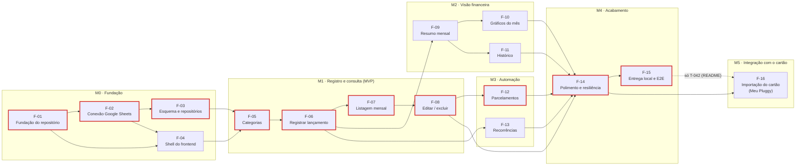

# 04 — Roadmap

| Campo | Valor |
|---|---|
| Documento | `SPECS/04-roadmap.md` |
| Versão | 1.1 |
| Atualizado em | 2026-11-12 |
| Status | Aprovado para início |
| Responde | **Em que ordem** construir: marcos, features, dependências e tarefas |
| Depende de | `01-requisitos.md`, `03-arquitetura.md` |
| Alimenta | `05-acompanhamento.md`, `features/F-xx-*.md` |

> **Regra para IA:** este documento define **o plano** (estável). O **estado** de cada tarefa fica só em `05-acompanhamento.md`. Nunca inicie uma tarefa cujas dependências não estejam `Concluída` lá.

---

## 1. Marcos

| Marco | Nome | Features | Resultado ao concluir |
|---|---|---|---|
| **M0** | Fundação | F-01, F-02, F-03, F-04 | Backend conecta na planilha e prepara as abas; frontend abre com shell e indica status da conexão. |
| **M1** | Registro e consulta (**MVP utilizável**) | F-05, F-06, F-07, F-08 | Usuário registra, lista, edita e exclui gastos e receitas por mês. |
| **M2** | Visão financeira | F-09, F-10, F-11 | Resumo, gráficos do mês e histórico. |
| **M3** | Automação | F-12, F-13 | Compras parceladas e recorrências automáticas. |
| **M4** | Acabamento | F-14, F-15 | App robusto, scripts de execução e verificação ponta a ponta. |
| **M5** | Integração com o cartão (Meu Pluggy) | F-16 | Gastos dos cartões de crédito importados do Meu Pluggy, conciliados com o que já foi lançado, mantidos em dia e acompanhados numa página de cartões. |

---

## 2. Grafo de dependências entre features

Uma seta `A --> B` significa "**B depende de A**" (A precisa estar concluída antes de B começar).

- **Caminho crítico** (borda vermelha): F-01 → F-02 → F-03 → F-05 → F-06 → F-07 → F-08 → F-12 → F-14 → F-15.
- **Paralelizável:** após F-06, três trilhas independentes: (F-07 → F-08 → F-12), (F-09 → F-10 / F-11) e (F-13). F-04 pode andar junto com F-03.
- **M5:** F-16 depende de F-14 (todas as telas e a resiliência prontas). Só a última tarefa (T-042, README e roteiro E2E) espera F-15 (T-035), porque edita o `README.md` final; as demais podem começar antes de F-15 terminar. Dentro de F-16, T-036 e T-037 são independentes; T-040 e T-041 também.

---

## 3. Features

Formato de cada feature: objetivo · requisitos cobertos · dependências · critério de conclusão · tarefas. O detalhamento de cada tarefa (dependências entre tarefas, status) está em `05-acompanhamento.md`. A spec detalhada da feature é criada em `SPECS/features/F-xx-<nome>.md` **antes** da primeira tarefa dela (comando `/especificar-feature`).

### F-01 — Fundação do repositório
- **Objetivo:** repositório versionado com segurança e esqueletos de backend e frontend que sobem vazios.
- **Cobre:** RNF-05 (parcial), RNF-01.
- **Depende de:** —
- **Concluída quando:** `git status` não lista `credentials.json`; `uvicorn` sobe e `ng serve` abre página padrão; `pytest` e `npm test` rodam (mesmo sem testes de negócio).
- **Tarefas:** T-001, T-002, T-003.

### F-02 — Conexão com Google Sheets
- **Objetivo:** backend autentica com a service account, abre a planilha por ID e reporta problemas de forma clara.
- **Cobre:** REQ-16, RNF-05.
- **Depende de:** F-01.
- **Concluída quando:** `GET /api/health` retorna `ok` com a planilha real e a mensagem correta para cada erro da tabela `02` §5.6 (testado com fakes).
- **Tarefas:** T-004, T-005, T-006.

### F-03 — Esquema e repositórios da planilha
- **Objetivo:** estrutura de abas criada automaticamente; camada de repositório (planilha + memória) e tipos de domínio base prontos.
- **Cobre:** REQ-15, RN-14, RN-15, RN-16.
- **Depende de:** F-02.
- **Concluída quando:** iniciar o backend numa planilha vazia cria as 4 abas com cabeçalho e categorias padrão; reiniciar não duplica nada; repositórios têm testes em memória e teste de integração.
- **Tarefas:** T-007, T-008, T-009.

### F-04 — Shell do frontend
- **Objetivo:** esqueleto navegável da SPA com layout, rotas, locale pt-BR, tratamento de erro e indicação de conexão.
- **Cobre:** REQ-01 (botão global), REQ-04 (seletor de mês), REQ-16, RNF-03, RNF-07.
- **Depende de:** F-01, F-02.
- **Concluída quando:** as 5 rotas abrem (placeholders), botão "Registrar gasto" visível em todas, banner aparece se o backend/planilha estiver indisponível.
- **Tarefas:** T-010, T-011, T-012.

### F-05 — Categorias
- **Objetivo:** CRUD de categorias com regras de unicidade, cor e desativação.
- **Cobre:** REQ-11, RN-12, RN-15.
- **Depende de:** F-03, F-04.
- **Concluída quando:** todos os CA-11.x passam (testes de API + tela funcional).
- **Tarefas:** T-013, T-014.

### F-06 — Registrar lançamento
- **Objetivo:** registrar gasto e receita pelo diálogo global.
- **Cobre:** REQ-01, REQ-02, RN-01..RN-06.
- **Depende de:** F-05.
- **Concluída quando:** CA-01.x e CA-02.x passam; linha aparece corretamente na planilha.
- **Tarefas:** T-015, T-016.

### F-07 — Listagem mensal
- **Objetivo:** ver lançamentos do mês com filtros, totais e navegação entre meses.
- **Cobre:** REQ-03, REQ-04, RN-13.
- **Depende de:** F-06.
- **Concluída quando:** CA-03.x e CA-04.x passam.
- **Tarefas:** T-017, T-018.

### F-08 — Editar e excluir lançamentos
- **Objetivo:** corrigir ou remover lançamentos pela listagem.
- **Cobre:** REQ-05, REQ-06.
- **Depende de:** F-07.
- **Concluída quando:** CA-05.x e CA-06.x passam; apenas a linha certa é alterada/removida mesmo após edição manual da planilha.
- **Tarefas:** T-019, T-020.

### F-09 — Resumo mensal
- **Objetivo:** somatórios do mês (gastos, receitas, saldo, por categoria, por forma de pagamento).
- **Cobre:** REQ-12, RN-13, RN-16.
- **Depende de:** F-06.
- **Concluída quando:** CA-12.x passam; totais conferem centavo a centavo com a planilha.
- **Tarefas:** T-021, T-022.

### F-10 — Gráficos do mês
- **Objetivo:** visualizações do mês usando as cores das categorias.
- **Cobre:** REQ-13.
- **Depende de:** F-09.
- **Concluída quando:** CA-13.x passam; estados vazios tratados.
- **Tarefas:** T-023.

### F-11 — Histórico
- **Objetivo:** evolução mês a mês de gastos, receitas, saldo e categorias.
- **Cobre:** REQ-14.
- **Depende de:** F-09.
- **Concluída quando:** CA-14.x passam.
- **Tarefas:** T-024, T-025.

### F-12 — Parcelamentos
- **Objetivo:** registrar compra parcelada e manter suas parcelas.
- **Cobre:** REQ-07, REQ-08, RN-07, RN-08.
- **Depende de:** F-08.
- **Concluída quando:** CA-07.x e CA-08.x passam; parcelas gravadas numa única chamada à API do Google.
- **Tarefas:** T-026, T-027.

### F-13 — Recorrências
- **Objetivo:** cadastrar recorrências e gerar lançamentos automaticamente ao abrir o app.
- **Cobre:** REQ-09, REQ-10, RN-09..RN-11.
- **Depende de:** F-06.
- **Concluída quando:** CA-09.x e CA-10.x passam, incluindo dia 31, pausa/reativação e não duplicação.
- **Tarefas:** T-028, T-029, T-030.

### F-14 — Polimento e resiliência
- **Objetivo:** experiência consistente em todas as telas e tratamento de edição manual da planilha.
- **Cobre:** REQ-16 (CA-16.2, CA-16.3), RN-14, RNF-04, RNF-06, RNF-07.
- **Depende de:** F-08, F-10, F-11, F-12, F-13.
- **Concluída quando:** todas as telas têm estados carregando/vazio/erro; botão "Recarregar dados" funciona; linhas inválidas são avisadas; metas de desempenho verificadas com 5.000 linhas.
- **Tarefas:** T-031, T-032.

### F-15 — Entrega local e verificação ponta a ponta
- **Objetivo:** subir o sistema com um comando e validar todos os requisitos.
- **Cobre:** RNF-01, RNF-08, todos os REQ (verificação).
- **Depende de:** F-14.
- **Concluída quando:** `scripts/start.ps1` sobe backend e frontend; testes de integração passam na planilha de teste; roteiro E2E executado com todos os itens OK; `README.md` final.
- **Tarefas:** T-033, T-034, T-035.

### F-16 — Importação do cartão de crédito (Meu Pluggy)
- **Objetivo:** trazer sozinhos os gastos dos cartões de crédito (Itaú, Nubank) do Meu Pluggy para a planilha, sem duplicar o que já foi lançado à mão, por recorrência ou por parcelamento.
- **Cobre:** REQ-17, REQ-18, REQ-19, REQ-20; CA-03.4/03.5, CA-08.3, CA-11.5; RN-03 (P-02), RN-08, RN-15, RN-17..RN-24; RNF-01, RNF-02, RNF-05, RNF-09.
- **Depende de:** F-14 (T-042 também de F-15/T-035).
- **Concluída quando:** com a integração configurada, abrir o app e "Buscar do cartão" importam, conciliam, atualizam e removem conforme RN-17..RN-24 (testes com `PluggyFalso`); planilha v1 migra para v2 sem perder nada; sem configuração o app funciona como antes; teste de contrato contra o item Sandbox passa; roteiro E2E da F-16 executado com o item real.
- **Tarefas:** T-036, T-037, T-038, T-039, T-040, T-041, T-042.

---

## 4. Matriz de rastreabilidade

| Requisito | Feature(s) | Tarefas |
|---|---|---|
| REQ-01 Registrar gasto | F-06 (F-04: botão global) | T-015, T-016 (T-010) |
| REQ-02 Registrar receita | F-06 | T-015, T-016 |
| REQ-03 Listar lançamentos | F-07 (F-16: CA-03.4/03.5) | T-017, T-018 (T-039, T-041) |
| REQ-04 Navegar entre meses | F-07 (F-04: seletor) | T-018 (T-011) |
| REQ-05 Editar lançamento | F-08 | T-019, T-020 |
| REQ-06 Excluir lançamento | F-08 | T-019, T-020 |
| REQ-07 Registrar parcelada | F-12 | T-026, T-027 |
| REQ-08 Manter parcelamento | F-12 (F-16: CA-08.3) | T-026, T-027 (T-036, T-041) |
| REQ-09 Gerenciar recorrências | F-13 | T-028, T-030 |
| REQ-10 Geração automática | F-13 | T-029, T-030 |
| REQ-11 Gerenciar categorias | F-05 (F-16: CA-11.5) | T-013, T-014 (T-036, T-041) |
| REQ-12 Resumo do mês | F-09 | T-021, T-022 |
| REQ-13 Gráficos do mês | F-10 | T-023 |
| REQ-14 Visão histórica | F-11 | T-024, T-025 |
| REQ-15 Preparação da planilha | F-03 (F-16: migração para a versão 2) | T-008 (T-036) |
| REQ-16 Feedback de erros | F-02, F-04, F-14 | T-004, T-005, T-012, T-031, T-032 |
| REQ-17 Importar gastos do cartão | F-16 | T-037, T-038, T-039, T-040, T-042 |
| REQ-18 Conciliar com lançamentos registrados | F-16 | T-038, T-039, T-041 |
| REQ-19 Manter importados em dia | F-16 | T-038, T-039 |
| REQ-20 Acompanhar cartões conectados | F-16 | T-037, T-039, T-040 |

Verificação: todo `REQ-xx` de `01-requisitos.md` aparece nesta tabela. Ao criar um requisito novo, acrescente-o aqui junto com a feature/tarefas que o cobrem.

---

## 5. Como evoluir o roadmap

- **Nova feature:** próximo ID livre (`F-17`, ...), acrescentar no §3, no grafo (§2), na matriz (§4) e as tarefas em `05-acompanhamento.md`.
- **Nova tarefa:** próximo ID livre (`T-043`, ...), mesmo que pertença a uma feature antiga. **IDs nunca são reaproveitados nem renumerados.**
- **Tarefa grande demais:** se uma tarefa não cabe em uma sessão do Claude Code (≈ um PR pequeno, até ~400 linhas alteradas), divida-a em novas tarefas e marque a original como `Concluída` com a nota "dividida em T-xxx, T-yyy" — ou mantenha-a como agrupadora.
- Alterações de escopo passam por `/mudanca-de-requisito`.

---

## Histórico de alterações

| Data | Versão | Alteração |
|---|---|---|
| 2026-09-29 | 1.0 | Versão inicial: 5 marcos, 15 features, 35 tarefas. |
| 2026-11-12 | 1.1 | Integração com o Meu Pluggy (`/mudanca-de-requisito`): marco **M5**, feature **F-16** (T-036 a T-042), grafo, matriz (REQ-17 a REQ-20 e acréscimos em REQ-03/08/11/15), próximos IDs livres. |
