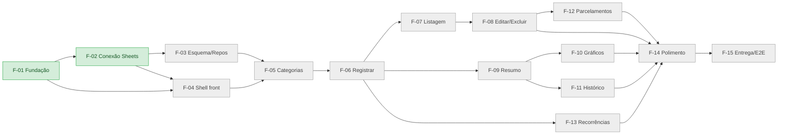

# 05 — Acompanhamento do Roadmap

| Campo | Valor |
|---|---|
| Documento | `SPECS/05-acompanhamento.md` |
| Atualizado em | 2026-09-29 |
| Responde | **Onde estamos:** status de cada tarefa e feature |
| Depende de | `04-roadmap.md` (plano) |

> **Regras para IA (obrigatórias):**
> 1. Status válidos, escritos exatamente assim: **`Não iniciada`**, **`Iniciada`**, **`Concluída`**.
> 2. Só marque `Iniciada` uma tarefa cujas dependências estejam **todas** `Concluída`. Preencha a coluna *Início*.
> 3. Só marque `Concluída` quando o critério de pronto for atendido (testes passando, `ruff check` limpo / `ng build` ok, specs afetadas atualizadas). Preencha *Conclusão* e *Notas* (hash do commit ou resumo).
> 4. Mantenha no máximo **uma** tarefa `Iniciada` por vez, salvo pedido explícito do usuário.
> 5. Ao concluir a última tarefa de uma feature, atualize a tabela de features (§2), o mapa de progresso (§3) e o resumo (§1).
> 6. Registre cada mudança de status no **Log** (§5), mais recente no topo.
> 7. Impedimentos (dúvida de requisito, credencial, etc.) vão na coluna *Notas* como `BLOQUEIO: ...` e no Log; o status não muda.

---

## 1. Resumo

| Marco | Features | Tarefas | Não iniciada | Iniciada | Concluída | Progresso |
|---|---|---|---|---|---|---|
| M0 · Fundação | F-01..F-04 | 12 | 6 | 0 | 6 | 50% |
| M1 · Registro e consulta | F-05..F-08 | 8 | 8 | 0 | 0 | 0% |
| M2 · Visão financeira | F-09..F-11 | 5 | 5 | 0 | 0 | 0% |
| M3 · Automação | F-12..F-13 | 5 | 5 | 0 | 0 | 0% |
| M4 · Acabamento | F-14..F-15 | 5 | 5 | 0 | 0 | 0% |
| **Total** | **15** | **35** | **29** | **0** | **6** | **17%** |

**F-01 e F-02 concluídas.** Próxima tarefa disponível: **T-007** (BE, início de F-03, caminho crítico) — F-03 ainda sem spec de feature, então o ciclo pede `/especificar-feature F-03` antes.

---

## 2. Features

| Feature | Nome | Marco | Status | Spec da feature |
|---|---|---|---|---|
| F-01 | Fundação do repositório | M0 | Concluída | [`F-01-fundacao-do-repositorio.md`](features/F-01-fundacao-do-repositorio.md) (Aprovada) |
| F-02 | Conexão com Google Sheets | M0 | Concluída | [`F-02-conexao-google-sheets.md`](features/F-02-conexao-google-sheets.md) (Aprovada) |
| F-03 | Esquema e repositórios da planilha | M0 | Não iniciada | — |
| F-04 | Shell do frontend | M0 | Não iniciada | — |
| F-05 | Categorias | M1 | Não iniciada | — |
| F-06 | Registrar lançamento | M1 | Não iniciada | — |
| F-07 | Listagem mensal | M1 | Não iniciada | — |
| F-08 | Editar e excluir lançamentos | M1 | Não iniciada | — |
| F-09 | Resumo mensal | M2 | Não iniciada | — |
| F-10 | Gráficos do mês | M2 | Não iniciada | — |
| F-11 | Histórico | M2 | Não iniciada | — |
| F-12 | Parcelamentos | M3 | Não iniciada | — |
| F-13 | Recorrências | M3 | Não iniciada | — |
| F-14 | Polimento e resiliência | M4 | Não iniciada | — |
| F-15 | Entrega local e verificação E2E | M4 | Não iniciada | — |

Status da feature: `Não iniciada` (nenhuma tarefa iniciada) · `Iniciada` (alguma tarefa iniciada ou concluída) · `Concluída` (todas concluídas). Na coluna *Spec da feature*, coloque o link do arquivo em `SPECS/features/` quando ele for criado.

---

## 3. Mapa de progresso

Para atualizar, mova o ID do nó entre as linhas `class ... naoIniciada/iniciada/concluida` no final do bloco.

---

## 4. Tarefas

Camadas: **BE** = backend · **FE** = frontend · **DOC** = documentação/infra do repositório.

### M0 · Fundação

| ID | Tarefa (escopo) | Feature | Camada | Depende de | Status | Início | Conclusão | Notas |
|---|---|---|---|---|---|---|---|---|
| T-001 | `git init`; `.gitignore` com todos os itens de `02` §6; pastas `backend/`, `frontend/`, `scripts/`; confirmar que `credentials.json` não aparece em `git status`. | F-01 | DOC | — | Concluída | 2026-09-29 | 2026-09-29 | Repo em `main`; `.gitignore` cobre `02` §6 + `.idea/`, `.vscode/`, `.ruff_cache/`, `*.py[cod]`, `.claude/settings.local.json`; `backend/` e `scripts/` com `.gitkeep`, `frontend/` vazia para o `ng new`; `deny` de terminal para a credencial em `.claude/settings.json`. CA-F01.1/.2/.3/.4/.19/.20 verificados. |
| T-002 | Esqueleto do backend: `requirements*.txt`, `pyproject.toml` (ruff, pytest com marcador `integracao`), `app/main.py` com app FastAPI e CORS, `app/config.py` (Settings), `.env.example`, `tests/conftest.py`, um teste trivial. | F-01 | BE | T-001 | Concluída | 2026-09-29 | 2026-09-29 | 9 testes verdes (1 `integracao` desselecionado), `ruff check`/`format` limpos, uvicorn real respondendo 200 em `/openapi.json` sem rotas `/api`. ADR-12 (fábrica + `Settings` preguiçoso). CA-F01.5 a .12. |
| T-003 | Esqueleto do frontend: `ng new frontend` com Angular CLI 22 (standalone, zoneless, SCSS, roteamento, Vitest — padrões da v22), Angular Material 22, `chart.js@^4`, `proxy.conf.json`, locale pt-BR/BRL em `app.config.ts`, script `npm start` usando o proxy. Conferir Node 24 LTS e TypeScript 6.0. | F-01 | FE | T-001 | Concluída | 2026-09-29 | 2026-09-29 | Angular 22.2.0 zoneless (sem `zone.js`), Material/CDK 22.2.0 tema azure claro/escuro, chart.js 4.5.1, TypeScript 6.0.2, Vitest 5. 4 testes verdes, build 248 kB, proxy `/api` validado contra o uvicorn real. ADR-13 (nomes 2025) e ADR-14 (prettier). CA-F01.13 a .18 e .21. |
| T-004 | `domain/erros.py` (exceções de conexão) e `infra/sheets_client.py`: carregar credenciais (`from_service_account_file`, escopos corretos), `open_by_key`, retry com backoff (429/5xx), mapear erros para exceções de domínio (`02` §5.6, incluindo o 403 de API desativada). Testes com cliente falso. | F-02 | BE | T-002 | Concluída | 2026-09-29 | 2026-09-29 | `domain/erros.py` (5 exceções de conexão + base) e `infra/sheets_client.py` (escopos, `open_by_key`, retry 2/4/8 s, tradução de §5.6 com 403 desambiguado). 20 testes novos, 29 no total; `ruff` limpo. CA-F02.1/.2/.3/.4/.11/.14 e a parte de domínio de CA-16.1. |
| T-005 | `api/erros.py` (handlers no formato `03` §6.2, incluindo erros do Pydantic → `VALIDACAO`), `api/deps.py`, lifespan que conecta sem derrubar o servidor (uma tentativa), `GET /api/health` que reconecta sob demanda. Testes de API. | F-02 | BE | T-004 | Concluída | 2026-09-29 | 2026-09-29 | Handlers de `03` §6.2 (inclusive erros do framework), `api/deps.py`, `ConexaoPlanilha`, lifespan tolerante e `GET /api/health` sempre 200 com nova tentativa. Logging INFO de `02` §3. 17 testes novos (46 no total); `ruff` limpo; fumaça com uvicorn real. CA-16.1, CA-16.2, CA-F02.5..10 e .12. |
| T-006 | `README.md` na raiz: pré-requisitos, preparação única da planilha (compartilhar com `client_email`, obter ID), configuração do `.env`, como rodar. | F-02 | DOC | T-004 | Concluída | 2026-09-29 | 2026-09-29 | `README.md` com pré-requisitos, preparação única da planilha (inclusive descobrir o `client_email` pelo próprio `/api/health`), `.env`, execução, testes, tabela dos 5 erros e seção de segurança. 6 testes guardam a documentação (52 no total). CA-F02.13 — falta só a leitura do usuário. |
| T-007 | Domínio base: `enums.py`, `dinheiro.py` (tipo `Dinheiro`, divisão em parcelas RN-07), `datas.py` (`somar_meses`, `ajustar_dia`, iteração de meses `YYYY-MM`), `modelos.py`. Testes cobrindo RN-07 e fim de mês/ano bissexto. | F-03 | BE | T-002 | Não iniciada | | | |
| T-008 | `infra/schema_planilha.py` (abas/colunas de `03` §5) e `infra/bootstrap.py` idempotente: cria abas e cabeçalhos, valida cabeçalhos, grava `versao_schema`, seed de categorias RN-15. Chamado no lifespan. Testes com planilha falsa. | F-03 | BE | T-005, T-007 | Não iniciada | | | |
| T-009 | `infra/cache.py` (TTL + invalidação), `repositories/base.py` (Protocols), `repositories/planilha/` (leitura UNFORMATTED, validação de linhas → `linhas_ignoradas`, `append_rows` RAW em lote, atualizar/remover localizando por `id`), `repositories/memoria/`. Testes unitários + 1 teste `@integracao`. | F-03 | BE | T-008 | Não iniciada | | | |
| T-010 | Shell: `app.ts` (classe `App`) com barra superior (botões "Registrar gasto"/"Registrar receita" ainda sem ação), navegação lateral, rotas lazy das 5 páginas (placeholders), `GraficoDirective` + `grafico.config.ts` em `shared/grafico/` (Chart.js direto, `02` §4) com teste unitário. | F-04 | FE | T-003 | Não iniciada | | | |
| T-011 | Core: `core/models` base (`ErroApi`, enums), `erro.interceptor.ts`, `ConexaoStore` + banner de erro, `MesSelecionadoStore` sincronizado com `?mes=`, `DadosStore`, `utils/mes.ts`, componentes `seletor-mes`, `confirmacao-dialog`, `estado-vazio`, `carregando`. Testes unitários. | F-04 | FE | T-010 | Não iniciada | | | |
| T-012 | `provideAppInitializer` chamando `GET /api/health`; banner com mensagem e "Tentar novamente" em falha (sem bloquear o app). | F-04 | FE | T-011, T-005 | Não iniciada | | | |

### M1 · Registro e consulta

| ID | Tarefa (escopo) | Feature | Camada | Depende de | Status | Início | Conclusão | Notas |
|---|---|---|---|---|---|---|---|---|
| T-013 | `categoria_service` (slug, unicidade sem acento/caixa, bloqueio de exclusão em uso, desativação) + router `/api/categorias` (GET/POST/PUT/DELETE). Testes CA-11.1..11.4. | F-05 | BE | T-007, T-009 | Não iniciada | | | |
| T-014 | Página `/categorias`: lista por tipo, criar/renomear/cor/ativar-desativar/excluir via diálogo; `CategoriasStore`. | F-05 | FE | T-013, T-011 | Não iniciada | | | |
| T-015 | `lancamento_service.criar` (RN-01..06) + `POST /api/lancamentos` + `GET /api/formas-pagamento`. Testes CA-01.x, CA-02.x. | F-06 | BE | T-013 | Não iniciada | | | |
| T-016 | `lancamento-form.dialog` (novo gasto/receita; form reativo tipado; data padrão hoje; só categorias ativas do tipo); ligar botões do shell; manter dados em erro (CA-01.4); `DadosStore.versao++` no sucesso. | F-06 | FE | T-015, T-014 | Não iniciada | | | |
| T-017 | `lancamento_service.listar(mes, filtros)` com totais e `linhas_ignoradas` + `GET /api/lancamentos`. Testes CA-03.x. | F-07 | BE | T-015 | Não iniciada | | | |
| T-018 | Página `/lancamentos`: tabela (data, descrição, categoria, forma, valor, "k/N"/ícone de recorrência), filtros, totais do backend, seletor de mês, estado vazio. | F-07 | FE | T-017, T-016 | Não iniciada | | | |
| T-019 | `lancamento_service.editar/excluir` + `PUT`/`DELETE /api/lancamentos/{id}` (404). Teste garantindo que só a linha certa muda após reordenação manual. | F-08 | BE | T-017 | Não iniciada | | | |
| T-020 | Ações editar (reusa o diálogo) e excluir (com `confirmacao-dialog`) na listagem. | F-08 | FE | T-019, T-018 | Não iniciada | | | |

### M2 · Visão financeira

| ID | Tarefa (escopo) | Feature | Camada | Depende de | Status | Início | Conclusão | Notas |
|---|---|---|---|---|---|---|---|---|
| T-021 | `resumo_service.mensal` (totais, saldo, por categoria/forma com %, acumulado diário) + `GET /api/resumo/mensal`. Testes CA-12.x e RN-16 (somas em centavos). | F-09 | BE | T-015 | Não iniciada | | | |
| T-022 | Página `/resumo`: cards de gastos/receitas/saldo (saldo negativo destacado), tabela por categoria e por forma, seletor de mês. | F-09 | FE | T-021, T-011 | Não iniciada | | | |
| T-023 | Gráficos no `/resumo`: rosca por categoria (cores da categoria), barras por forma de pagamento, linha do acumulado diário; estados vazios. | F-10 | FE | T-022 | Não iniciada | | | |
| T-024 | `resumo_service.historico` (meses sem lançamento com zero, por categoria alinhado aos meses, total e média) + `GET /api/resumo/historico` (padrão últimos 12). Testes CA-14.x. | F-11 | BE | T-021 | Não iniciada | | | |
| T-025 | Página `/historico`: seletor de intervalo, barras gastos x receitas, linha de saldo, barras empilhadas por categoria, total e média do período. | F-11 | FE | T-024, T-011 | Não iniciada | | | |

### M3 · Automação

| ID | Tarefa (escopo) | Feature | Camada | Depende de | Status | Início | Conclusão | Notas |
|---|---|---|---|---|---|---|---|---|
| T-026 | `parcelamento_service` (RN-07/08) + `POST /api/parcelamentos` (uma única escrita em lote) + `DELETE /api/parcelamentos/{id}`. Testes CA-07.x, CA-08.x. | F-12 | BE | T-019 | Não iniciada | | | |
| T-027 | No diálogo: opção "Compra parcelada" + nº de parcelas com prévia do valor da parcela; na listagem: exibir "k/N" e ação "Excluir parcelamento inteiro". | F-12 | FE | T-026, T-020 | Não iniciada | | | |
| T-028 | Aba/repositório de recorrências (se ainda faltar), `recorrencia_service` CRUD + mudança de status (reativação sem retroativos) + routers GET/POST/PUT/PATCH status. Testes CA-09.x. | F-13 | BE | T-015 | Não iniciada | | | |
| T-029 | `recorrencia_service.sincronizar` (algoritmo `03` §4.4) + `POST /api/recorrencias/sincronizar`. Testes CA-10.1..10.4, dia 31, `mes_fim`, pausa. | F-13 | BE | T-028 | Não iniciada | | | |
| T-030 | Página `/recorrencias` (lista com status e próximo mês, criar/editar/pausar/reativar/encerrar) + sincronização no inicializador do app com snackbar. | F-13 | FE | T-029, T-016, T-012 | Não iniciada | | | |

### M4 · Acabamento

| ID | Tarefa (escopo) | Feature | Camada | Depende de | Status | Início | Conclusão | Notas |
|---|---|---|---|---|---|---|---|---|
| T-031 | Revisão de todas as telas: carregando/vazio/erro, responsividade ≥ 360 px, mensagens em pt-BR, acessibilidade básica (labels, foco no diálogo). | F-14 | FE | T-020, T-023, T-025, T-027, T-030 | Não iniciada | | | |
| T-032 | `POST /api/sistema/recarregar` + botão "Recarregar dados"; aviso de `linhas_ignoradas` na interface; teste de desempenho com 5.000 linhas (RNF-04) usando repositório em memória e planilha de teste. | F-14 | BE+FE | T-031 | Não iniciada | | | |
| T-033 | `scripts/start-backend.ps1`, `scripts/start-frontend.ps1`, `scripts/start.ps1` (sobe ambos e abre o navegador). | F-15 | DOC | T-032 | Não iniciada | | | |
| T-034 | Suíte `tests/integracao/` completa contra `SPREADSHEET_ID_TESTE` (bootstrap, CRUD, parcelamento, sincronização). | F-15 | BE | T-032 | Não iniciada | | | |
| T-035 | Roteiro E2E manual cobrindo todos os CA-xx (em `SPECS/features/F-15-*.md`), execução e registro do resultado; `README.md` final. | F-15 | DOC | T-033, T-034 | Não iniciada | | | |

---

## 5. Log

| Data | Tarefa/Feature | Mudança | Observação |
|---|---|---|---|
| 2026-09-29 | T-006 / F-02 | `Iniciada` → `Concluída` | README da raiz. **F-02 concluída** (§2 e §3 atualizados). `03` → 1.5 (`README.md` na árvore). |
| 2026-09-29 | F-02 | PENDÊNCIA de verificação | CA-F02.13 depende de o usuário seguir o README do zero com a planilha real (criar, compartilhar, `.env`, subir). Não bloqueia T-007, mas **deve ser feito antes de T-008**, que exige planilha acessível. |
| 2026-09-29 | T-006 | `Não iniciada` → `Iniciada` | Dependência T-004 `Concluída`. Última tarefa de F-02. |
| 2026-09-29 | T-005 | `Iniciada` → `Concluída` | Camada HTTP de erros e o primeiro endpoint do contrato. `03` → 1.4 (envelope para erros do framework; `ConexaoPlanilha` em §3). Teste de fronteira de T-002 renomeado (nota em F-01 §8). Sugestão de `logging` (aberta desde T-002) implementada. |
| 2026-09-29 | T-005 | Sugestão anotada | `conexao.exigir_planilha()` já existe para os endpoints de negócio responderem 503 (`03` §4.5), mas ninguém a usa ainda — T-009/T-013 devem chamá-la em vez de checar conexão por conta própria. |
| 2026-09-29 | T-005 | `Não iniciada` → `Iniciada` | Dependência T-004 `Concluída`. |
| 2026-09-29 | T-004 | `Iniciada` → `Concluída` | Cliente da planilha com retry e tradução de erros. Nenhuma mudança em `02`/`03` (a árvore de `03` §3 já previa os dois módulos); refinamentos registrados em F-02 §3.2 e §10. |
| 2026-09-29 | T-004 | Sugestão anotada | O retry está exposto como `executar_com_retry(...)` genérico; T-009 deve reaproveitá-lo nas leituras/escritas em vez de criar outro. |
| 2026-09-29 | T-004 | `Não iniciada` → `Iniciada` | Dependência T-002 `Concluída`; spec F-02 `Aprovada`. F-02 passa a `Iniciada` (§2) e o mapa (§3) foi atualizado. |
| 2026-09-29 | F-02 | Spec da feature criada e **aprovada** | Q1–Q6 decididas. Escopo de T-004 e T-005 ajustado (`domain/erros.py` → T-004; `api/deps.py` → T-005). `02` → 1.6 (403 desambiguado, `ApiSheetsDesabilitada`); `03` → 1.3 (código novo + esquema do health). Nenhum status de tarefa alterado. |
| 2026-09-29 | T-003 / F-01 | `Iniciada` → `Concluída` | Esqueleto do frontend Angular 22. **F-01 concluída** (§2 e §3 atualizados). `02` → 1.5 (ADR-13, ADR-14); `03` → 1.2 (componente raiz `app.ts`). CA-F01.14 refinado na spec de F-01. |
| 2026-09-29 | T-003 | Sugestões anotadas | (1) O `ng add` do Material aponta Roboto e Material Symbols para o Google Fonts; num app 100% local (RNF-01) valeria auto-hospedar as fontes — avaliar em **T-031** (polimento). (2) `app.html` ainda é a página de boas-vindas do CLI (20 KB); some em **T-010**. |
| 2026-09-29 | T-003 | `Não iniciada` → `Iniciada` | Dependência T-001 `Concluída`. Angular CLI, Material e Chart.js disponíveis em 22.2.0 / 22.2.0 / 4.5.1. |
| 2026-09-29 | T-002 | `Iniciada` → `Concluída` | Esqueleto do backend com `Settings`, CORS e suíte de testes. `02` → 1.3 (ADR-12 e padrões da suíte). CA-F01.7 refinado na spec de F-01. |
| 2026-09-29 | T-002 | Sugestões anotadas | (1) `logging` nível INFO (`02` §3) não foi configurado — fora do escopo de T-002; fazer em **T-005**, que já mexe em inicialização e erros. (2) O Starlette instalado avisa que `httpx` no `TestClient` está deprecado em favor de `httpx2`; trocar exige mudar `02` §1.1 + ADR — avaliar quando incomodar. |
| 2026-09-29 | T-002 | `Não iniciada` → `Iniciada` | Dependência T-001 `Concluída`. |
| 2026-09-29 | T-001 | `Iniciada` → `Concluída` | `git init -b main`, `.gitignore`, pastas e reforço do `deny` da credencial. `02` → 1.2 (§10). Sem teste automatizado (ainda não há executor no repo); verificação por comando registrada nas Notas. |
| 2026-09-29 | T-001 | `Não iniciada` → `Iniciada` | Sem dependências; spec F-01 `Aprovada`. F-01 passa a `Iniciada` (§2) e o mapa (§3) foi atualizado. |
| 2026-09-29 | F-01 | Spec da feature criada | `features/F-01-fundacao-do-repositorio.md` **Aprovada**: Q1–Q7 respondidas pelo usuário. Nenhum status de tarefa alterado. |
| 2026-09-29 | T-003, T-010 | Escopo ajustado | Migração para Angular 22 (ADR-10) e gráficos com Chart.js direto (ADR-11). |
| 2026-09-29 | — | Criação do acompanhamento | 35 tarefas em `Não iniciada`. |
