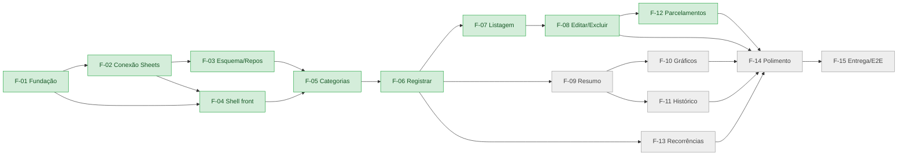

# 05 — Acompanhamento do Roadmap

| Campo | Valor |
|---|---|
| Documento | `SPECS/05-acompanhamento.md` |
| Atualizado em | 2026-09-30 |
| Responde | **Onde estamos:** status de cada tarefa e feature |
| Depende de | `04-roadmap.md` (plano) |

> **Regras para IA (obrigatórias):**
> 1. Status válidos, escritos exatamente assim: **`Não iniciada`**, **`Iniciada`**, **`Concluída`**.
> 2. Só marque `Iniciada` uma tarefa cujas dependências estejam **todas** `Concluída`. Preencha a coluna *Início*.
> 3. Só marque `Concluída` quando o critério de pronto for atendido (testes passando, `ruff check` limpo / `ng build` ok, specs afetadas atualizadas). Preencha *Conclusão* e *Notas* (hash do commit ou resumo).
> 4. Mantenha no máximo **uma** tarefa `Iniciada` por vez, salvo pedido explícito do usuário.
> 5. Ao concluir a última tarefa de uma feature, atualize a tabela de features (§2), o mapa de progresso (§3) e o resumo (§1).
> 6. Registre cada mudança de status no **Log** (§5), mais recente no topo.
> 7. Impedimentos (dúvida de requisito, credencial, etc.) vão na coluna *Notas* como `BLOQUEIO: ...` e no Log; o status não muda.

---

## 1. Resumo

| Marco | Features | Tarefas | Não iniciada | Iniciada | Concluída | Progresso |
|---|---|---|---|---|---|---|
| M0 · Fundação | F-01..F-04 | 12 | 0 | 0 | 12 | 100% |
| M1 · Registro e consulta | F-05..F-08 | 8 | 0 | 0 | 8 | 100% |
| M2 · Visão financeira | F-09..F-11 | 5 | 5 | 0 | 0 | 0% |
| M3 · Automação | F-12..F-13 | 5 | 3 | 0 | 2 | 40% |
| M4 · Acabamento | F-14..F-15 | 5 | 5 | 0 | 0 | 0% |
| **Total** | **15** | **35** | **13** | **0** | **22** | **63%** |

**M0 e M1 concluídos (F-01 a F-08); F-12 concluída.** O caminho crítico (F-14) agora espera F-10, F-11 e F-13. Desbloqueadas: **T-021** (BE, F-09 — spec aprovada; próximo passo: `/implementar-tarefa T-021`) e T-028 (BE, F-13 — sem spec). Pendentes com o usuário, sem bloquear: seguir o README com a planilha real (CA-F02.13), rodar `pytest -m integracao` (CA-15.1/15.2) e a conferência visual (CA-F04.7, CA-F04.30, CA-F05.20, F-06 borda 16, CA-F07.18, menu ⋮ de F-08 em 360 px).

---

## 2. Features

| Feature | Nome | Marco | Status | Spec da feature |
|---|---|---|---|---|
| F-01 | Fundação do repositório | M0 | Concluída | [`F-01-fundacao-do-repositorio.md`](features/F-01-fundacao-do-repositorio.md) (Aprovada) |
| F-02 | Conexão com Google Sheets | M0 | Concluída | [`F-02-conexao-google-sheets.md`](features/F-02-conexao-google-sheets.md) (Aprovada) |
| F-03 | Esquema e repositórios da planilha | M0 | Concluída | [`F-03-esquema-e-repositorios.md`](features/F-03-esquema-e-repositorios.md) (Concluída) |
| F-04 | Shell do frontend | M0 | Concluída | [`F-04-shell-do-frontend.md`](features/F-04-shell-do-frontend.md) (Concluída) |
| F-05 | Categorias | M1 | Concluída | [`F-05-categorias.md`](features/F-05-categorias.md) (Concluída) |
| F-06 | Registrar lançamento | M1 | Concluída | [`F-06-registrar-lancamento.md`](features/F-06-registrar-lancamento.md) (Concluída) |
| F-07 | Listagem mensal | M1 | Concluída | [`F-07-listagem-mensal.md`](features/F-07-listagem-mensal.md) (Concluída) |
| F-08 | Editar e excluir lançamentos | M1 | Concluída | [`F-08-editar-excluir-lancamentos.md`](features/F-08-editar-excluir-lancamentos.md) (Concluída) |
| F-09 | Resumo mensal | M2 | Não iniciada | [`F-09-resumo-mensal.md`](features/F-09-resumo-mensal.md) (Aprovada) |
| F-10 | Gráficos do mês | M2 | Não iniciada | — |
| F-11 | Histórico | M2 | Não iniciada | — |
| F-12 | Parcelamentos | M3 | Concluída | [`F-12-parcelamentos.md`](features/F-12-parcelamentos.md) (Concluída) |
| F-13 | Recorrências | M3 | Não iniciada | — |
| F-14 | Polimento e resiliência | M4 | Não iniciada | — |
| F-15 | Entrega local e verificação E2E | M4 | Não iniciada | — |

Status da feature: `Não iniciada` (nenhuma tarefa iniciada) · `Iniciada` (alguma tarefa iniciada ou concluída) · `Concluída` (todas concluídas). Na coluna *Spec da feature*, coloque o link do arquivo em `SPECS/features/` quando ele for criado.

---

## 3. Mapa de progresso

Para atualizar, mova o ID do nó entre as linhas `class ... naoIniciada/iniciada/concluida` no final do bloco.

---

## 4. Tarefas

Camadas: **BE** = backend · **FE** = frontend · **DOC** = documentação/infra do repositório.

### M0 · Fundação

| ID | Tarefa (escopo) | Feature | Camada | Depende de | Status | Início | Conclusão | Notas |
|---|---|---|---|---|---|---|---|---|
| T-001 | `git init`; `.gitignore` com todos os itens de `02` §6; pastas `backend/`, `frontend/`, `scripts/`; confirmar que `credentials.json` não aparece em `git status`. | F-01 | DOC | — | Concluída | 2026-09-29 | 2026-09-29 | Repo em `main`; `.gitignore` cobre `02` §6 + `.idea/`, `.vscode/`, `.ruff_cache/`, `*.py[cod]`, `.claude/settings.local.json`; `backend/` e `scripts/` com `.gitkeep`, `frontend/` vazia para o `ng new`; `deny` de terminal para a credencial em `.claude/settings.json`. CA-F01.1/.2/.3/.4/.19/.20 verificados. |
| T-002 | Esqueleto do backend: `requirements*.txt`, `pyproject.toml` (ruff, pytest com marcador `integracao`), `app/main.py` com app FastAPI e CORS, `app/config.py` (Settings), `.env.example`, `tests/conftest.py`, um teste trivial. | F-01 | BE | T-001 | Concluída | 2026-09-29 | 2026-09-29 | 9 testes verdes (1 `integracao` desselecionado), `ruff check`/`format` limpos, uvicorn real respondendo 200 em `/openapi.json` sem rotas `/api`. ADR-12 (fábrica + `Settings` preguiçoso). CA-F01.5 a .12. |
| T-003 | Esqueleto do frontend: `ng new frontend` com Angular CLI 22 (standalone, zoneless, SCSS, roteamento, Vitest — padrões da v22), Angular Material 22, `chart.js@^4`, `proxy.conf.json`, locale pt-BR/BRL em `app.config.ts`, script `npm start` usando o proxy. Conferir Node 24 LTS e TypeScript 6.0. | F-01 | FE | T-001 | Concluída | 2026-09-29 | 2026-09-29 | Angular 22.2.0 zoneless (sem `zone.js`), Material/CDK 22.2.0 tema azure claro/escuro, chart.js 4.5.1, TypeScript 6.0.2, Vitest 5. 4 testes verdes, build 248 kB, proxy `/api` validado contra o uvicorn real. ADR-13 (nomes 2025) e ADR-14 (prettier). CA-F01.13 a .18 e .21. |
| T-004 | `domain/erros.py` (exceções de conexão) e `infra/sheets_client.py`: carregar credenciais (`from_service_account_file`, escopos corretos), `open_by_key`, retry com backoff (429/5xx), mapear erros para exceções de domínio (`02` §5.6, incluindo o 403 de API desativada). Testes com cliente falso. | F-02 | BE | T-002 | Concluída | 2026-09-29 | 2026-09-29 | `domain/erros.py` (5 exceções de conexão + base) e `infra/sheets_client.py` (escopos, `open_by_key`, retry 2/4/8 s, tradução de §5.6 com 403 desambiguado). 20 testes novos, 29 no total; `ruff` limpo. CA-F02.1/.2/.3/.4/.11/.14 e a parte de domínio de CA-16.1. |
| T-005 | `api/erros.py` (handlers no formato `03` §6.2, incluindo erros do Pydantic → `VALIDACAO`), `api/deps.py`, lifespan que conecta sem derrubar o servidor (uma tentativa), `GET /api/health` que reconecta sob demanda. Testes de API. | F-02 | BE | T-004 | Concluída | 2026-09-29 | 2026-09-29 | Handlers de `03` §6.2 (inclusive erros do framework), `api/deps.py`, `ConexaoPlanilha`, lifespan tolerante e `GET /api/health` sempre 200 com nova tentativa. Logging INFO de `02` §3. 17 testes novos (46 no total); `ruff` limpo; fumaça com uvicorn real. CA-16.1, CA-16.2, CA-F02.5..10 e .12. |
| T-006 | `README.md` na raiz: pré-requisitos, preparação única da planilha (compartilhar com `client_email`, obter ID), configuração do `.env`, como rodar. | F-02 | DOC | T-004 | Concluída | 2026-09-29 | 2026-09-29 | `README.md` com pré-requisitos, preparação única da planilha (inclusive descobrir o `client_email` pelo próprio `/api/health`), `.env`, execução, testes, tabela dos 5 erros e seção de segurança. 6 testes guardam a documentação (52 no total). CA-F02.13 — falta só a leitura do usuário. |
| T-007 | Domínio base: `enums.py`, `dinheiro.py` (tipo `Dinheiro`, divisão em parcelas RN-07), `datas.py` (`somar_meses`, `ajustar_dia`, iteração de meses `YYYY-MM`), `modelos.py`. Testes cobrindo RN-07 e fim de mês/ano bissexto. | F-03 | BE | T-002 | Concluída | 2026-09-30 | 2026-09-30 | `enums`, `dinheiro` (tipo `Dinheiro`, `valor_da_planilha`, `dividir_em_parcelas` em centavos inteiros), `datas` (inclui `data_da_parcela` a partir da compra) e `modelos` (linha válida de `03` §5, com regras entre campos, e `ListagemComAvisos[T]`); `NaoEncontrado` e `ErroValidacao` em `erros.py`. 431 testes novos (483 no total, maioria parametrização N=2..48); `ruff` limpo. CA-F03.1 a .8. |
| T-008 | `infra/schema_planilha.py` (abas/colunas de `03` §5) e `infra/bootstrap.py` idempotente: cria abas e cabeçalhos, valida cabeçalhos, grava `versao_schema`, seed de categorias RN-15. Chamado no lifespan. Testes com planilha falsa. | F-03 | BE | T-005, T-007 | Concluída | 2026-09-30 | 2026-09-30 | `schema_planilha.py` (fonte única das 4 abas) e `bootstrap.py` em duas fases (valida tudo → escreve só o que falta; seed RN-15 em uma escrita). Roda a cada conexão estabelecida, injetado em `ConexaoPlanilha` (`03` §4.5). `SchemaPlanilhaInvalido` → 503 + linha no README. `tests/planilha_falsa.py` exige RAW/UNFORMATTED e argumentos nomeados. 44 testes novos (527 no total); `ruff` limpo. CA-F03.9..15, .24, .25; CA-15.1/15.2 com planilha falsa. |
| T-009 | `infra/cache.py` (TTL + invalidação), `repositories/base.py` (Protocols), `repositories/planilha/` (leitura UNFORMATTED, validação de linhas → `linhas_ignoradas`, `append_rows` RAW em lote, atualizar/remover localizando por `id`), `repositories/memoria/`. Testes unitários + 1 teste `@integracao`. | F-03 | BE | T-008 | Concluída | 2026-09-30 | 2026-09-30 | `infra/cache.py` (TTL + geração por aba contra corrida leitura×escrita), `repositories/base.py` (`Repositorio[T]` + 3 Protocols), `planilha/aba.py` genérico (leitura única UNFORMATTED → validação pelo modelo, `linhas_ignoradas` + WARNING; `append_rows` RAW + `INSERT_ROWS`; atualizar/remover relendo a aba, remoção em um `batch_update` tudo-ou-nada), `memoria/` equivalente (teste dedicado nas 3 entidades), `ConexaoPlanilha.executar`. 58 testes novos (585 no total) + 1 `@integracao` pronto; `ruff` limpo. CA-16.3, CA-F03.16..23. |
| T-010 | Shell: `app.ts` (classe `App`) com barra superior (botões "Registrar gasto"/"Registrar receita" ainda sem ação), navegação lateral, rotas lazy das 5 páginas (placeholders), `GraficoDirective` + `grafico.config.ts` em `shared/grafico/` (Chart.js direto, `02` §4) com teste unitário. | F-04 | FE | T-003 | Concluída | 2026-09-30 | 2026-09-30 | Shell (`app.ts`) com barra, navegação lateral e layout por largura via `BreakpointObserver` (Q1); 5 páginas provisórias lazy com título de aba; `/` e rota desconhecida → `/resumo`; `GraficoDirective` + `grafico.config.ts` (registro enxuto, pt-BR, reais, cores do tema e troca claro/escuro). Página de boas-vindas do CLI removida. 16 testes novos (20 no total); build 437 kB inicial, 5 chunks lazy, sem avisos. CA-F04.1..6, .8..12 (+ .7 e .30 com conferência visual pendente). |
| T-011 | Core: `core/models` base (`ErroApi`, enums), `erro.interceptor.ts`, `ConexaoStore` + banner de erro, `MesSelecionadoStore` sincronizado com `?mes=`, `DadosStore`, `utils/mes.ts`, componentes `seletor-mes`, `confirmacao-dialog`, `estado-vazio`, `carregando`. Testes unitários. | F-04 | FE | T-010 | Concluída | 2026-09-30 | 2026-09-30 | `core/`: `ErroApi`/`RespostaHealth`/enums, `HealthApi`, `erro.interceptor` (503 e backend fora → banner; 422 → formulário; demais → aviso), `ConexaoStore`, `MesSelecionadoStore` (lê/corrige `?mes=` com `replaceUrl`), `DadosStore`, `utils/mes.ts`, `avisos` (snackbar sob demanda). `shared/components/`: seletor de mês com datepicker ano→mês, `confirmacao-dialog`, `estado-vazio`, `carregando`, `banner-conexao` (no shell). Links de Resumo/Lançamentos levam `?mes=`. 38 testes novos (58 no total); build 463 kB inicial, sem avisos. CA-04.1, CA-04.2, CA-F04.13..22, .31. |
| T-012 | `provideAppInitializer` chamando `GET /api/health`; banner com mensagem e "Tentar novamente" em falha (sem bloquear o app). | F-04 | FE | T-011, T-005 | Concluída | 2026-09-30 | 2026-09-30 | `ConexaoStore.verificar()` (uma requisição por vez, `tentando`), `tentarNovamente()` (aviso de 4 s + `DadosStore.incrementar()` quando volta), `provideVerificacaoDeConexao()` sem espera; botão "Tentar novamente"/"Tentando…" no banner. 11 testes novos (69 no total); build 465 kB. Contrato conferido com `ng serve` + uvicorn de config falsa (proxy dá 502 com backend desligado). CA-16.1, CA-16.2, CA-F04.23..29. |

### M1 · Registro e consulta

| ID | Tarefa (escopo) | Feature | Camada | Depende de | Status | Início | Conclusão | Notas |
|---|---|---|---|---|---|---|---|---|
| T-013 | `categoria_service` (slug, unicidade sem acento/caixa, bloqueio de exclusão em uso, desativação) + router `/api/categorias` (GET/POST/PUT/DELETE). Testes CA-11.1..11.4. | F-05 | BE | T-007, T-009 | Concluída | 2026-09-30 | 2026-09-30 | `categoria_service` (normalização, chave sem acento/caixa, slug com sufixo, ordem, `em_uso`, CRUD, bloqueio de uso em qualquer status de recorrência), `CategoriaDuplicada`/`CategoriaEmUso` → 409, schemas com limite de 40 só na entrada, router `/api/categorias`, `deps.Repositorios` + cache e repositórios únicos no lifespan. 57 testes novos (642 no total); `ruff` limpo; fumaça com uvicorn real. CA-11.1, CA-F05.1..13, .21..23 (+ parte BE de CA-11.2/.3/.4). |
| T-014 | Página `/categorias`: lista por tipo, criar/renomear/cor/ativar-desativar/excluir via diálogo; `CategoriasStore`. | F-05 | FE | T-013, T-011 | Concluída | 2026-09-30 | 2026-09-30 | Página `/categorias` (seções Gastos/Receitas, selo Inativa, menu ⋮ com Editar, Desativar/Reativar, Excluir — em uso oferece desativar; aviso de re-seed na última), `categoria-form.dialog` (salva sozinho; 409/422 no campo; contador 40; paleta de 24 com pré-seleção e cor extra), `CategoriasApi`, `CategoriasStore` (carga única + recarga por `versao`), `paleta.ts`, `src/testing/`. Shell sem `mat-nav-list` (decisão do usuário; pacote 529→456 kB). 22 testes novos (91 no total); build sem avisos. CA-11.3, CA-F05.14..19, .24 (+ .20 visual pendente). |
| T-015 | `lancamento_service.criar` (RN-01..06) + `POST /api/lancamentos` + `GET /api/formas-pagamento`. Testes CA-01.x, CA-02.x. | F-06 | BE | T-013 | Concluída | 2026-09-30 | 2026-09-30 | `lancamento_service.criar` (existe → mesmo tipo → ativa → forma no gasto; uma escrita; resposta com nome/cor da categoria), `CategoriaInativa`/`CategoriaTipoIncompativel` → 409, `ErroValidacao.no_campo` com `detalhes`, schemas `LancamentoEntrada`/`LancamentoSaida`/`FormaPagamentoSaida`, `POST /api/lancamentos`, `GET /api/formas-pagamento` (sem planilha). 41 testes novos (683 no total); `ruff` limpo. CA-F06.1..8 (+ parte BE de CA-02.2). |
| T-016 | `lancamento-form.dialog` (novo gasto/receita; form reativo tipado; data padrão hoje; só categorias ativas do tipo); ligar botões do shell; manter dados em erro (CA-01.4); `DadosStore.versao++` no sucesso. Marcador `TRATAMENTO_LOCAL` no interceptor, aplicado também ao diálogo de categoria (F-06 Q3). | F-06 | FE | T-015, T-014 | Concluída | 2026-09-30 | 2026-09-30 | `lancamento-form.dialog` (tipo fixo, hoje por padrão, foco no valor, valor pt-BR reformatado ao sair, só categorias ativas do tipo com cor, "Não informar" na receita, orientação sem categorias; salva sozinho e mantém os dados em 422/409/503/sem backend), `abrir-lancamento.ts` (aviso + `versao++`) aberto pelo shell via `import()`, `LancamentosApi`, `FormasPagamentoApi`/`Store`, `utils/valor.ts`, `AdaptadorDeDataPtBr`, marcador `TRATAMENTO_LOCAL` (também no diálogo de categoria). 48 testes novos (139 no total); build 472 kB inicial + 39 kB do diálogo, sem avisos. CA-01.1..01.4, CA-02.1/.2, CA-F06.9..16 (+ CA-01.5 parcial). |
| T-017 | `lancamento_service.listar(mes, filtros)` com totais e `linhas_ignoradas` + `GET /api/lancamentos`. Testes CA-03.x. | F-07 | BE | T-015 | Concluída | 2026-09-30 | 2026-09-30 | `lancamento_service.listar` (mês de referência, filtros E, ordem data→criado_em→id desc, totais `Decimal` do filtrado, nome/cor atuais ou "Categoria não encontrada", `linhas_ignoradas`), tipo `Montante`, `ListaLancamentosSaida`, `GET /api/lancamentos` (`mes` obrigatório `YYYY-MM`). 25 testes novos (708 no total); 5.000 linhas com uma leitura por aba; `ruff` limpo. CA-F07.1..9. |
| T-018 | Página `/lancamentos`: tabela (data, descrição, categoria, forma, valor, "k/N"/ícone de recorrência), filtros, totais do backend, seletor de mês, estado vazio. | F-07 | FE | T-017, T-016 | Concluída | 2026-09-30 | 2026-09-30 | Página `/lancamentos`: seletor de mês, filtros tipo/categoria/forma na URL (`replaceUrl`, inválidos descartados, categoria dependente do tipo, inativas incluídas), cartões de totais da API (saldo negativo em destaque), tabela ≥ 600 px / cartões abaixo, valor "− R$"/"+ R$" verde com `aria-label`, "3/10", ícone de recorrência, observação, estados carregando/recarga esmaecida/vazio/erro, busca com sequência (descarta resposta atrasada) e recarga por `versao`. `exibirData` no lugar do `DatePipe` (pacote 486→474 kB). 14 testes novos (153 no total); build sem avisos. CA-03.1..03.3, CA-01.5, CA-11.2, CA-F07.10..20. |
| T-019 | `lancamento_service.editar/excluir` + `PUT`/`DELETE /api/lancamentos/{id}` (404). Teste garantindo que só a linha certa muda após reordenação manual. | F-08 | BE | T-017 | Concluída | 2026-09-30 | 2026-09-30 | `lancamento_service.editar` (404 antes das regras; qualquer campo, inclusive tipo; categoria atual inativa permitida — Q1; preserva id/parcela/recorrência/criado_em; `atualizado_em` novo) e `excluir` (só a linha do `id`), validação compartilhada `_validar`, mensagem "Lançamento não encontrado.", `PUT`/`DELETE /api/lancamentos/{id}`. 21 testes novos (729 no total), inclusive com a planilha reordenada à mão; `ruff` limpo. CA-05.2, CA-05.3, CA-F08.1..9 (+ parte BE de CA-06.2). |
| T-020 | Ações editar (reusa o diálogo) e excluir (com `confirmacao-dialog`) na listagem. | F-08 | FE | T-019, T-018 | Concluída | 2026-09-30 | 2026-09-30 | `LancamentosApi.atualizar/excluir`; diálogo em modo edição (título "Editar gasto/receita", campo Tipo com troca que limpa a categoria do outro tipo e ajusta a forma, categoria atual inativa "(inativa)" — Q1, linha de parcela/recorrência, `PUT`, 404 fecha e recarrega); `editarLancamento` com aviso do mês novo (Q3); menu ⋮ na tabela (coluna "Ações") e nos cartões (Q2); confirmação com descrição, valor, data e extras de parcela/recorrência; recarga no sucesso e no 404, não com a planilha fora (borda 12). 16 testes novos (169 no total); build 474,24 kB inicial. CA-05.1, CA-06.1, CA-06.2, CA-F08.10..17. |

### M2 · Visão financeira

| ID | Tarefa (escopo) | Feature | Camada | Depende de | Status | Início | Conclusão | Notas |
|---|---|---|---|---|---|---|---|---|
| T-021 | `resumo_service.mensal` (totais, saldo, por categoria/forma com %, acumulado diário) + `GET /api/resumo/mensal`. Testes CA-12.x e RN-16 (somas em centavos). | F-09 | BE | T-015 | Não iniciada | | | |
| T-022 | Página `/resumo`: cards de gastos/receitas/saldo (saldo negativo destacado), tabela por categoria e por forma, seletor de mês. | F-09 | FE | T-021, T-011 | Não iniciada | | | |
| T-023 | Gráficos no `/resumo`: rosca por categoria (cores da categoria), barras por forma de pagamento, linha do acumulado diário; estados vazios. | F-10 | FE | T-022 | Não iniciada | | | |
| T-024 | `resumo_service.historico` (meses sem lançamento com zero, por categoria alinhado aos meses, total e média) + `GET /api/resumo/historico` (padrão últimos 12). Testes CA-14.x. | F-11 | BE | T-021 | Não iniciada | | | |
| T-025 | Página `/historico`: seletor de intervalo, barras gastos x receitas, linha de saldo, barras empilhadas por categoria, total e média do período. | F-11 | FE | T-024, T-011 | Não iniciada | | | |

### M3 · Automação

| ID | Tarefa (escopo) | Feature | Camada | Depende de | Status | Início | Conclusão | Notas |
|---|---|---|---|---|---|---|---|---|
| T-026 | `parcelamento_service` (RN-07/08) + `POST /api/parcelamentos` (uma única escrita em lote) + `DELETE /api/parcelamentos/{id}`. Testes CA-07.x, CA-08.x. | F-12 | BE | T-019 | Concluída | 2026-09-30 | 2026-09-30 | `parcelamento_service.criar` (limites de parcelas/valor antes da categoria, com erro no campo; validação compartilhada `validar_categoria_e_forma`; `dividir_em_parcelas` + `data_da_parcela`; N parcelas num `inserir`) e `excluir` (parcelas restantes em qualquer mês, num `remover`; uma nova tentativa com a aba relida se a planilha mudou; 404 "Parcelamento não encontrado."); `POST`/`DELETE /api/parcelamentos`. 34 testes novos (763 no total), inclusive com planilha reordenada e linha apagada à mão; `ruff` limpo. CA-07.1..3, CA-08.1, CA-F12.1..9 (+ parte BE de CA-08.2). |
| T-027 | No diálogo: opção "Compra parcelada" + nº de parcelas com prévia do valor da parcela; na listagem: exibir "k/N" e ação "Excluir parcelamento inteiro". | F-12 | FE | T-026, T-020 | Concluída | 2026-09-30 | 2026-09-30 | `ParcelamentosApi`; `utils/parcelas.ts` (prévia de RN-07 em centavos inteiros, só para exibir — Q1); no diálogo, "Compra parcelada" só em gasto novo (rótulos "Valor total"/"Data da compra", "Nº de parcelas" 2–48, mínimo por parcela no Valor total, prévia, `POST /api/parcelamentos`, 422 de `valor_total`/`parcelas` no campo certo); aviso com o intervalo de meses (Q3); "Excluir parcelamento inteiro" no menu ⋮ das parcelas (Q2) com confirmação, recarga no sucesso e no 404, não no 503. 12 testes novos (183 no total); build 475,94 kB inicial (+1,7 kB do `mat-checkbox`, ver Log). CA-08.2, CA-F12.10..15. |
| T-028 | Aba/repositório de recorrências (se ainda faltar), `recorrencia_service` CRUD + mudança de status (reativação sem retroativos) + routers GET/POST/PUT/PATCH status. Testes CA-09.x. | F-13 | BE | T-015 | Não iniciada | | | |
| T-029 | `recorrencia_service.sincronizar` (algoritmo `03` §4.4) + `POST /api/recorrencias/sincronizar`. Testes CA-10.1..10.4, dia 31, `mes_fim`, pausa. | F-13 | BE | T-028 | Não iniciada | | | |
| T-030 | Página `/recorrencias` (lista com status e próximo mês, criar/editar/pausar/reativar/encerrar) + sincronização no inicializador do app com snackbar. | F-13 | FE | T-029, T-016, T-012 | Não iniciada | | | |

### M4 · Acabamento

| ID | Tarefa (escopo) | Feature | Camada | Depende de | Status | Início | Conclusão | Notas |
|---|---|---|---|---|---|---|---|---|
| T-031 | Revisão de todas as telas: carregando/vazio/erro, responsividade ≥ 360 px, mensagens em pt-BR, acessibilidade básica (labels, foco no diálogo). | F-14 | FE | T-020, T-023, T-025, T-027, T-030 | Não iniciada | | | |
| T-032 | `POST /api/sistema/recarregar` + botão "Recarregar dados"; aviso de `linhas_ignoradas` na interface; teste de desempenho com 5.000 linhas (RNF-04) usando repositório em memória e planilha de teste. | F-14 | BE+FE | T-031 | Não iniciada | | | |
| T-033 | `scripts/start-backend.ps1`, `scripts/start-frontend.ps1`, `scripts/start.ps1` (sobe ambos e abre o navegador). | F-15 | DOC | T-032 | Não iniciada | | | |
| T-034 | Suíte `tests/integracao/` completa contra `SPREADSHEET_ID_TESTE` (bootstrap, CRUD, parcelamento, sincronização). | F-15 | BE | T-032 | Não iniciada | | | |
| T-035 | Roteiro E2E manual cobrindo todos os CA-xx (em `SPECS/features/F-15-*.md`), execução e registro do resultado; `README.md` final. | F-15 | DOC | T-033, T-034 | Não iniciada | | | |

---

## 5. Log

| Data | Tarefa/Feature | Mudança | Observação |
|---|---|---|---|
| 2026-09-30 | F-09 | Spec da feature criada e **aprovada** | `features/F-09-resumo-mensal.md`: Q1–Q2 respondidas (ambas na opção recomendada). Única precisão sobre `03`: `mes` obrigatório em `GET /api/resumo/mensal` (T-021 marca em §6.1). Nenhum status de tarefa alterado. |
| 2026-09-30 | F-12 | `Iniciada` → `Concluída` | Última tarefa (T-027) concluída; §2 e mapa (§3) atualizados. |
| 2026-09-30 | T-027 | `Iniciada` → `Concluída` | Parcelamentos na tela. `03` → 1.25 (§3). Nenhuma dependência nova. Pacote inicial de 474,24 para 475,94 kB: o `mat-checkbox` usa `_MatInternalFormField`, de `@angular/material/core`, que já está no pacote inicial (mesmo caso do `MatOption` em T-016); abaixo do orçamento de 500 kB. |
| 2026-09-30 | T-027 | `Não iniciada` → `Iniciada` | Dependências T-026 e T-020 `Concluída`. Última tarefa de F-12. |
| 2026-09-30 | T-026 | `Iniciada` → `Concluída` | Parcelamentos no backend. `03` → 1.24 (§3, §4.4). Guarda de rotas com `POST /api/parcelamentos` e `DELETE /api/parcelamentos/{parcelamento_id}`. Nenhuma dependência nova. |
| 2026-09-30 | T-026 | `Não iniciada` → `Iniciada` | Dependência T-019 `Concluída`; spec F-12 `Aprovada`. F-12 passa a `Iniciada` (§2) e o mapa (§3) foi atualizado. |
| 2026-09-30 | F-12 | Spec da feature criada e **aprovada** | `features/F-12-parcelamentos.md`: Q1–Q3 respondidas (todas na opção recomendada). Nenhuma mudança em 01–03. Nenhum status de tarefa alterado. |
| 2026-09-30 | M1 | **Marco concluído** | F-05 a F-08 `Concluída`. Caminho crítico segue em F-12 (sem spec). |
| 2026-09-30 | F-08 | `Iniciada` → `Concluída` | Última tarefa (T-020) concluída; §2 e mapa (§3) atualizados. |
| 2026-09-30 | T-020 | `Iniciada` → `Concluída` | Edição e exclusão na tela. `03` → 1.23 (§3). Nenhuma dependência nova. |
| 2026-09-30 | T-020 | `Não iniciada` → `Iniciada` | Dependências T-019 e T-018 `Concluída`. Última tarefa de F-08 e do M1. |
| 2026-09-30 | T-019 | `Iniciada` → `Concluída` | Edição e exclusão no backend. Nenhuma mudança em 01–03 (contrato já previsto). Guarda de rotas com `PUT` e `DELETE /api/lancamentos/{id}`. |
| 2026-09-30 | T-019 | `Não iniciada` → `Iniciada` | Dependência T-017 `Concluída`; spec F-08 `Aprovada`. F-08 passa a `Iniciada` (§2) e o mapa (§3) foi atualizado. |
| 2026-09-30 | F-08 | Spec da feature criada e **aprovada** | `features/F-08-editar-excluir-lancamentos.md`: Q1–Q3 respondidas (todas na opção recomendada). Nenhuma mudança em 01–03. Nenhum status de tarefa alterado. |
| 2026-09-30 | T-018 / F-07 | `Iniciada` → `Concluída` | Página de lançamentos. **F-07 concluída** (§2 e §3 atualizados). `03` → 1.22. CA-11.2 de F-05 fechado (exibição verificada aqui). `BreakpointsFalsos` virou helper comum em `src/testing/`. |
| 2026-09-30 | T-018 | Sugestão anotada | Pacote inicial: o `DatePipe` numa página lazy levou +11 kB ao inicial (o `@angular/common` já está nele e o esbuild divide por módulo). Regra prática para as próximas telas (F-09 a F-13): formatar datas e valores com os utilitários de `core/utils/` em vez de `DatePipe`/`CurrencyPipe`, e medir o pacote a cada tarefa de frontend. |
| 2026-09-30 | T-018 | `Não iniciada` → `Iniciada` | Dependências T-017 e T-016 `Concluída`. Última tarefa de F-07. |
| 2026-09-30 | T-017 | `Iniciada` → `Concluída` | Listagem mensal no backend. `02` → 1.10 (`Montante`), `03` → 1.21 (§6.3). Guarda de rotas com `GET /api/lancamentos`. |
| 2026-09-30 | T-017 | `Não iniciada` → `Iniciada` | Dependência T-015 `Concluída`; spec F-07 `Aprovada`. F-07 passa a `Iniciada` (§2) e o mapa (§3) foi atualizado. |
| 2026-09-30 | F-07 | Spec da feature criada e **aprovada** | `features/F-07-listagem-mensal.md`: Q1–Q3 respondidas (todas na opção recomendada). `03` → 1.20 (§8.1, filtros na URL). Nenhum status de tarefa alterado. |
| 2026-09-30 | T-016 / F-06 | `Iniciada` → `Concluída` | Diálogo de registro. **F-06 concluída** (§2 e §3 atualizados). `03` → 1.19 (arquivos novos em §3). Revisão registrada em F-05 (aviso duplicado corrigido). |
| 2026-09-30 | T-016 | Sugestão anotada | Pacote inicial em 472 kB (aviso em 500): o `app.config` importa o adaptador de data de `@angular/material/core`, que reexporta o `MatOption` — com o `mat-select` do diálogo, o esbuild o compartilha com o pacote inicial (~16 kB). Se a margem apertar, mover `provideNativeDateAdapter`/`AdaptadorDeDataPtBr` para os `providers` das rotas e do diálogo. Avaliar em T-031. |
| 2026-09-30 | T-016 | `Não iniciada` → `Iniciada` | Dependências T-015 e T-014 `Concluída`. Última tarefa de F-06. |
| 2026-09-30 | T-015 | `Iniciada` → `Concluída` | Registro de lançamentos no backend. `03` → 1.18 (§6.2: 422 de regra com campo em `detalhes`). Guarda de rotas com `POST /api/lancamentos` e `GET /api/formas-pagamento`. |
| 2026-09-30 | T-015 | `Não iniciada` → `Iniciada` | Dependência T-013 `Concluída`; spec F-06 `Aprovada`. F-06 passa a `Iniciada` (§2) e o mapa (§3) foi atualizado. |
| 2026-09-30 | F-06 | Spec da feature criada e **aprovada** | `features/F-06-registrar-lancamento.md`: Q1–Q4 respondidas (todas na opção recomendada). Q3 amplia T-016: marcador `TRATAMENTO_LOCAL` no interceptor, aplicado também ao diálogo de categoria de F-05. `03` → 1.17 (§8.4). Nenhum status de tarefa alterado. |
| 2026-09-30 | T-014 / F-05 | `Iniciada` → `Concluída` | Página de categorias. **F-05 concluída** (§2 e §3 atualizados). `02` → 1.9 (padrões da suíte do frontend), `03` → 1.16. Specs de T-011 passaram a usar `provideMaterialParaTestes()` (sugestão de T-011 implementada). |
| 2026-09-30 | T-014 | Desvio aprovado | O diálogo de categoria (1º formulário reativo) fez o `mat-nav-list` do shell (T-010) levar `@angular/forms` inteiro ao pacote inicial: 529 kB, acima do aviso de 500 kB. Com aprovação do usuário, a navegação virou `<nav>` com links simples → 456 kB. Revisão registrada em F-04. |
| 2026-09-30 | T-014 | Sugestão anotada | Acompanhar o pacote inicial a cada tarefa de frontend (hoje 456 kB): o shell deve continuar só com toolbar, sidenav, button e icon do Material. Diálogos e formulários ficam nas páginas lazy — inclusive o de lançamento (T-016), que abre pelo shell e deve ser importado sob demanda. |
| 2026-09-30 | T-014 | `Não iniciada` → `Iniciada` | Dependências T-013 e T-011 `Concluída`. Última tarefa de F-05. |
| 2026-09-30 | T-013 | `Iniciada` → `Concluída` | Primeiro endpoint de negócio. `03` → 1.15 (`deps.Repositorios`, lifespan com cache e repositórios únicos). Teste de guarda de rotas atualizado para a lista exata do contrato; `test_camadas` ganhou a regra de `services`. |
| 2026-09-30 | T-013 | Observação | Não existe `backend/.env` nesta máquina (o app recusa subir sem `SPREADSHEET_ID`, como decidido em F-01). Confirma que a conferência com a planilha real (CA-F02.13) ainda está pendente. |
| 2026-09-30 | T-013 | `Não iniciada` → `Iniciada` | Dependências T-007 e T-009 `Concluída`; spec F-05 `Aprovada`. F-05 passa a `Iniciada` (§2) e o mapa (§3) foi atualizado. Abre o M1. |
| 2026-09-30 | F-05 | Spec da feature criada e **aprovada** | `features/F-05-categorias.md`: Q1–Q5 respondidas (todas na opção recomendada); pendência cruzada anotada para F-13 (recorrência com categoria desativada). `03` → 1.14 (esquema `Categoria` com `em_uso`). Nenhum status de tarefa alterado. |
| 2026-09-30 | M0 | **Marco concluído** | F-01 a F-04 concluídas (12/12 tarefas). Verificações que dependem do usuário e não bloqueiam M1: CA-F02.13 (README com a planilha real), CA-15.1/15.2 (`pytest -m integracao` na planilha de teste), CA-F04.7 e CA-F04.30 (conferência visual). |
| 2026-09-30 | T-012 / F-04 | `Iniciada` → `Concluída` | Verificação na abertura e "Tentar novamente". **F-04 concluída** (§2 e §3 atualizados). `03` → 1.13 (§7.2; §8.4 com o 502 real do proxy). Conferência sem navegador: uvicorn com credencial inexistente e ID falso (nenhum acesso ao Google) + `ng serve` na porta 4299; ambos encerrados ao fim. |
| 2026-09-30 | T-012 | `Não iniciada` → `Iniciada` | Dependências T-011 e T-005 `Concluída`. Última tarefa de F-04. |
| 2026-09-30 | T-011 | `Iniciada` → `Concluída` | Erros, estado e componentes comuns. `03` → 1.12 (`core/avisos`, stores, banner; snackbar sob demanda em §8.4). F-04 §9 ajustado (banner já em T-011) e quatro decisões em §10. |
| 2026-09-30 | T-011 | Sugestão anotada | Nos testes, o Material precisa de `MATERIAL_ANIMATIONS` com `animationsDisabled` (o jsdom não dispara fim de animação CSS) e, para foco em diálogos, de um `InteractivityChecker` que trate elementos como visíveis. Se mais specs precisarem (T-014, T-016, T-020), vale um helper comum em `src/testing/`. A conferência visual pendente de T-010 passa a incluir o seletor de mês (posição do calendário sob o botão). |
| 2026-09-30 | T-011 | `Não iniciada` → `Iniciada` | Dependência T-010 `Concluída`. |
| 2026-09-30 | T-010 | `Iniciada` → `Concluída` | Shell, rotas e gráficos. `03` → 1.11 (páginas `<nome>.page.ts`, layout e título em §8.1). Três decisões de implementação em F-04 §10 (sonda de cores do tema, fonte Material Symbols, `merge` do Chart.js). |
| 2026-09-30 | T-010 | PENDÊNCIA de verificação | Conferência visual com `npm start`: janelas de 360, 600 e 960 px sem rolagem horizontal, nos temas claro e escuro (CA-F04.7). A troca de tema nos gráficos (CA-F04.30) só fica observável quando uma página usar gráfico (T-023). |
| 2026-09-30 | T-010 | Sugestão anotada | O pacote inicial passou de 248 kB para 437 kB (Material: toolbar, sidenav, list, button, icon) — abaixo do aviso de 500 kB do `angular.json`. Acompanhar em T-031, junto com a auto-hospedagem das fontes. |
| 2026-09-30 | T-010 | `Não iniciada` → `Iniciada` | Dependência T-003 `Concluída`; spec F-04 `Aprovada`. F-04 passa a `Iniciada` (§2) e o mapa (§3) foi atualizado. Escolhida antes de T-013 pelo usuário: fechar F-04 e então especificar F-05. |
| 2026-09-30 | T-009 / F-03 | `Iniciada` → `Concluída` | Cache e repositórios. **F-03 concluída** (§2 e §3 atualizados). `02` → 1.8 (`INSERT_ROWS`, aplicado também ao bootstrap), `03` → 1.10 (`repositories/`, `executar`). `README.md` §4 explica como rodar `pytest -m integracao` (variável no terminal, planilha separada compartilhada). |
| 2026-09-30 | T-009 | Sugestões anotadas | (1) **T-013**: montar em `api/deps.py` **uma** `CacheAbas(settings.cache_ttl_segundos)` compartilhada e os repositórios de planilha com `FontePlanilha = app.state.conexao`; os testes de API trocam por `repositories.memoria` via `dependency_overrides`. (2) **T-032**: "Recarregar" = `cache.invalidar_tudo()`. (3) O `conftest` usa `setdefault` para `GOOGLE_CREDENTIALS_PATH`: se essa variável existir no terminal, o `pytest` comum tentaria a credencial real no lifespan (falharia sem rede, sem dano, mas contraria a intenção). Avaliar forçar o caminho falso e manter o real só em `CREDENCIAL_DO_AMBIENTE` — fora do escopo de T-009. |
| 2026-09-30 | T-009 | `Não iniciada` → `Iniciada` | Dependência T-008 `Concluída`. Última tarefa de F-03. |
| 2026-09-30 | T-008 | `Iniciada` → `Concluída` | Bootstrap idempotente ligado à conexão. `03` → 1.9 (§4.5 bootstrap a cada conexão e colunas extras; §4.4 sem seed no serviço; `planilha_falsa.py` em §3). F-03 §3.4 e §10 refinados. `README.md` §5 ganhou a linha de `SCHEMA_PLANILHA_INVALIDO` (a guarda de T-006 cobrou) e o teste da guarda passou a ignorar o ponto final ao comparar mensagens. |
| 2026-09-30 | T-008 | Sugestões anotadas | (1) **T-009**: reaproveitar `tests/planilha_falsa.py`, acrescentando só o que faltar (ex.: `delete_rows`/`batch_clear`), mantendo a exigência de RAW/UNFORMATTED. (2) Planilha nova do Google vem com uma aba padrão ("Página1"/"Sheet1"); o bootstrap a deixa intacta (borda 8). Avaliar em **T-031** se vale citar no README ou removê-la quando estiver vazia — hoje seria comportamento fora da spec. |
| 2026-09-30 | T-008 | `Não iniciada` → `Iniciada` | Dependências T-005 e T-007 `Concluída`. A pendência de CA-F02.13 (planilha real) **não** bloqueia: os testes usam planilha falsa; só a conferência manual final depende dela. |
| 2026-09-30 | F-04 | Spec da feature criada e **aprovada** | `features/F-04-shell-do-frontend.md`: Q1–Q7 respondidas (todas na opção recomendada). `03` → 1.8 (§8.4, código local `BACKEND_INDISPONIVEL`). Nenhum status de tarefa alterado. |
| 2026-09-30 | T-007 | `Iniciada` → `Concluída` | Domínio base de F-03. `03` → 1.7 (funções de `datas.py`; `domain` importa o próprio `domain`, e `test_camadas` passou a checar também bibliotecas externas). Decisões em F-03 §10. |
| 2026-09-30 | T-007 | Sugestões anotadas | (1) **T-009**: antes de `model_validate`, tirar espaços das células, trocar `""` por `None` e passar `valor` por `valor_da_planilha` — o modelo recusa `42.500000000000004` (mais de 2 casas); daí em diante a validação de linha é só `ValidationError` → ignorada. (2) **Serviços (T-013 em diante)**: `model_copy(update=...)` do Pydantic **não valida**; para editar, usar `Modelo.model_validate({**item.model_dump(), ...})`. |
| 2026-09-30 | T-007 | `Não iniciada` → `Iniciada` | Dependência T-002 `Concluída`; spec F-03 `Aprovada`. F-03 passa a `Iniciada` (§2) e o mapa (§3) foi atualizado. |
| 2026-09-29 | F-03 | Spec da feature criada e **aprovada** | Q1–Q4 decididas. **P-03 confirmada** (`01` → 1.1). Paleta das 15 categorias padrão definida; total mínimo `N × R$ 0,01` para parcelar; `SchemaPlanilhaInvalido` → `02` → 1.7 e `03` → 1.6. Nenhum status de tarefa alterado. |
| 2026-09-29 | T-006 / F-02 | `Iniciada` → `Concluída` | README da raiz. **F-02 concluída** (§2 e §3 atualizados). `03` → 1.5 (`README.md` na árvore). |
| 2026-09-29 | F-02 | PENDÊNCIA de verificação | CA-F02.13 depende de o usuário seguir o README do zero com a planilha real (criar, compartilhar, `.env`, subir). Não bloqueia T-007, mas **deve ser feito antes de T-008**, que exige planilha acessível. |
| 2026-09-29 | T-006 | `Não iniciada` → `Iniciada` | Dependência T-004 `Concluída`. Última tarefa de F-02. |
| 2026-09-29 | T-005 | `Iniciada` → `Concluída` | Camada HTTP de erros e o primeiro endpoint do contrato. `03` → 1.4 (envelope para erros do framework; `ConexaoPlanilha` em §3). Teste de fronteira de T-002 renomeado (nota em F-01 §8). Sugestão de `logging` (aberta desde T-002) implementada. |
| 2026-09-29 | T-005 | Sugestão anotada | `conexao.exigir_planilha()` já existe para os endpoints de negócio responderem 503 (`03` §4.5), mas ninguém a usa ainda — T-009/T-013 devem chamá-la em vez de checar conexão por conta própria. |
| 2026-09-29 | T-005 | `Não iniciada` → `Iniciada` | Dependência T-004 `Concluída`. |
| 2026-09-29 | T-004 | `Iniciada` → `Concluída` | Cliente da planilha com retry e tradução de erros. Nenhuma mudança em `02`/`03` (a árvore de `03` §3 já previa os dois módulos); refinamentos registrados em F-02 §3.2 e §10. |
| 2026-09-29 | T-004 | Sugestão anotada | O retry está exposto como `executar_com_retry(...)` genérico; T-009 deve reaproveitá-lo nas leituras/escritas em vez de criar outro. |
| 2026-09-29 | T-004 | `Não iniciada` → `Iniciada` | Dependência T-002 `Concluída`; spec F-02 `Aprovada`. F-02 passa a `Iniciada` (§2) e o mapa (§3) foi atualizado. |
| 2026-09-29 | F-02 | Spec da feature criada e **aprovada** | Q1–Q6 decididas. Escopo de T-004 e T-005 ajustado (`domain/erros.py` → T-004; `api/deps.py` → T-005). `02` → 1.6 (403 desambiguado, `ApiSheetsDesabilitada`); `03` → 1.3 (código novo + esquema do health). Nenhum status de tarefa alterado. |
| 2026-09-29 | T-003 / F-01 | `Iniciada` → `Concluída` | Esqueleto do frontend Angular 22. **F-01 concluída** (§2 e §3 atualizados). `02` → 1.5 (ADR-13, ADR-14); `03` → 1.2 (componente raiz `app.ts`). CA-F01.14 refinado na spec de F-01. |
| 2026-09-29 | T-003 | Sugestões anotadas | (1) O `ng add` do Material aponta Roboto e Material Symbols para o Google Fonts; num app 100% local (RNF-01) valeria auto-hospedar as fontes — avaliar em **T-031** (polimento). (2) `app.html` ainda é a página de boas-vindas do CLI (20 KB); some em **T-010**. |
| 2026-09-29 | T-003 | `Não iniciada` → `Iniciada` | Dependência T-001 `Concluída`. Angular CLI, Material e Chart.js disponíveis em 22.2.0 / 22.2.0 / 4.5.1. |
| 2026-09-29 | T-002 | `Iniciada` → `Concluída` | Esqueleto do backend com `Settings`, CORS e suíte de testes. `02` → 1.3 (ADR-12 e padrões da suíte). CA-F01.7 refinado na spec de F-01. |
| 2026-09-29 | T-002 | Sugestões anotadas | (1) `logging` nível INFO (`02` §3) não foi configurado — fora do escopo de T-002; fazer em **T-005**, que já mexe em inicialização e erros. (2) O Starlette instalado avisa que `httpx` no `TestClient` está deprecado em favor de `httpx2`; trocar exige mudar `02` §1.1 + ADR — avaliar quando incomodar. |
| 2026-09-29 | T-002 | `Não iniciada` → `Iniciada` | Dependência T-001 `Concluída`. |
| 2026-09-29 | T-001 | `Iniciada` → `Concluída` | `git init -b main`, `.gitignore`, pastas e reforço do `deny` da credencial. `02` → 1.2 (§10). Sem teste automatizado (ainda não há executor no repo); verificação por comando registrada nas Notas. |
| 2026-09-29 | T-001 | `Não iniciada` → `Iniciada` | Sem dependências; spec F-01 `Aprovada`. F-01 passa a `Iniciada` (§2) e o mapa (§3) foi atualizado. |
| 2026-09-29 | F-01 | Spec da feature criada | `features/F-01-fundacao-do-repositorio.md` **Aprovada**: Q1–Q7 respondidas pelo usuário. Nenhum status de tarefa alterado. |
| 2026-09-29 | T-003, T-010 | Escopo ajustado | Migração para Angular 22 (ADR-10) e gráficos com Chart.js direto (ADR-11). |
| 2026-09-29 | — | Criação do acompanhamento | 35 tarefas em `Não iniciada`. |
