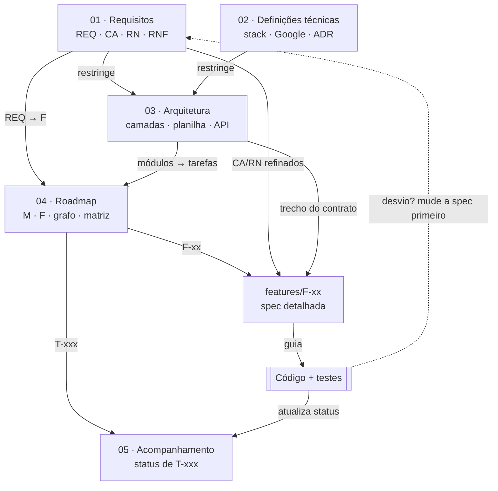
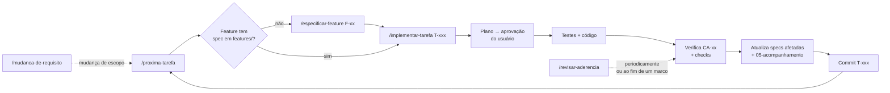

# SPECS — Planilha Financeira

Este diretório é a **fonte da verdade** do projeto. O desenvolvimento segue **SDD (Spec-Driven Development)**: primeiro a spec descreve o comportamento e as decisões; depois o código é escrito para cumpri-la; quando algo precisa mudar, **muda-se a spec antes do código**.

O desenvolvimento é assistido pelo **Claude Code**. O arquivo `CLAUDE.md` na raiz importa este README, e os comandos em `.claude/commands/` automatizam o ciclo descrito abaixo.

---

## 1. Mapa dos documentos

| # | Documento | Pergunta que responde | Nível | Muda com que frequência |
|---|---|---|---|---|
| 01 | [`01-requisitos.md`](01-requisitos.md) | **O quê** e **por quê** — requisitos, critérios de aceite, regras de negócio | Produto (sem técnica) | Raramente, via `/mudanca-de-requisito` |
| 02 | [`02-definicoes-tecnicas.md`](02-definicoes-tecnicas.md) | **Com o quê** — stack, versões, Google APIs, convenções, testes, ADRs | Técnico | Quando uma decisão técnica é tomada (novo ADR) |
| 03 | [`03-arquitetura.md`](03-arquitetura.md) | **Como se organiza** — camadas, pastas, modelo da planilha, contrato da API, fluxos | Técnico | Sempre que um endpoint, coluna ou módulo é criado/alterado |
| 04 | [`04-roadmap.md`](04-roadmap.md) | **Em que ordem** — marcos, features, grafo de dependências, rastreabilidade | Planejamento | Quando entram novas features/tarefas |
| 05 | [`05-acompanhamento.md`](05-acompanhamento.md) | **Onde estamos** — status de cada tarefa e feature, log | Execução | A cada tarefa iniciada/concluída |
| F | [`features/F-xx-*.md`](features/) | **Detalhe de uma feature** — comportamento fino, casos de borda, plano de testes | Feature | Criada antes da 1ª tarefa da feature; congelada ao concluir |

Modelo para specs de feature: [`features/_TEMPLATE.md`](features/_TEMPLATE.md).

---

## 2. Como as specs se relacionam

### 2.1 Precedência em caso de conflito

1. **`01-requisitos`** manda no **comportamento** (o quê).
2. **`02-definicoes-tecnicas`** manda em **tecnologia e convenções**.
3. **`03-arquitetura`** manda em **estrutura, dados e contrato**.
4. **`features/F-xx`** detalha, mas **não pode contradizer** 01–03. Se precisar, altere o documento superior antes.
5. **O código nunca é referência** para decidir o que é correto: se o código diverge da spec, o código está errado — ou a spec deve ser atualizada conscientemente.

---

## 3. Sistema de IDs

IDs são **estáveis**: nunca reutilizados nem renumerados. Itens removidos ficam marcados `(removido)`.

| Prefixo | Significa | Definido em | Exemplo |
|---|---|---|---|
| `REQ-xx` | Requisito funcional | 01 | REQ-01 Registrar gasto |
| `CA-xx.y` | Critério de aceite do REQ-xx | 01 / features | CA-01.3 |
| `RN-xx` | Regra de negócio | 01 | RN-07 Parcelamento |
| `RNF-xx` | Requisito não funcional | 01 | RNF-05 Segurança |
| `P-xx` | Premissa a confirmar | 01 | P-02 Mês do cartão |
| `ADR-xx` | Decisão técnica | 02 | ADR-04 Escrita RAW |
| `M<n>` | Marco | 04 | M1 MVP |
| `F-xx` | Feature | 04 | F-12 Parcelamentos |
| `T-xxx` | Tarefa implementável | 04 / 05 | T-026 |

**Rastreabilidade ponta a ponta:** `REQ-xx` → `F-xx` (matriz em 04) → `T-xxx` (05) → commit `T-xxx: ...` → teste `test_..._RN_xx` / `..._CA_xx_y`.

---

## 4. Ciclo SDD por tarefa (com Claude Code)

| Passo | Comando | O que acontece |
|---|---|---|
| 1 | `/proxima-tarefa` | Lê `05`, lista tarefas desbloqueadas e recomenda a próxima (prioriza o caminho crítico). Não altera arquivos. |
| 2 | `/especificar-feature F-xx` | Cria `features/F-xx-<nome>.md` a partir do template, com perguntas em aberto para o usuário. Sem código. |
| 3 | `/implementar-tarefa T-xxx` | Valida dependências, marca `Iniciada`, apresenta plano, implementa com testes, verifica critérios, atualiza specs e marca `Concluída`. |
| 4 | `/revisar-aderencia [F-xx]` | Compara código x specs (endpoints, colunas, regras de camadas, cobertura de RN) e relata divergências. |
| — | `/mudanca-de-requisito <descrição>` | Analisa impacto de uma mudança e atualiza 01 → 02/03 → 04 → 05, nessa ordem, após aprovação. |

---

## 5. Leitura mínima por tipo de tarefa

Para economizar contexto, leia **somente** o necessário:

| Tipo de tarefa | Ler |
|---|---|
| Qualquer tarefa | Linha da tarefa em `05`; feature em `04` §3; spec `features/F-xx` |
| Backend (BE) | REQ/RN citados em `01`; `02` §3, §5, §7, §8; `03` §4, §5, §6 |
| Frontend (FE) | REQ/CA citados em `01`; `02` §4, §7; `03` §6 (contratos usados), §8 |
| Documentação/infra (DOC) | `02` §2, §6; `03` §3 |
| Mudança de escopo | `01` inteiro; `04` §2–§4 |

---

## 6. Definição de Pronto (vale para toda tarefa)

- [ ] Todos os critérios de aceite (CA) e regras (RN) cobertos pela tarefa foram verificados — preferencialmente por teste automatizado.
- [ ] Backend: `pytest` verde e `ruff check .` limpo. Frontend: `npm test` verde e `npm run build` sem erros.
- [ ] Nenhuma regra de dependência de camadas violada (`03` §4.2).
- [ ] Endpoints, colunas, pastas ou dependências novas refletidos em `03`/`02` (com ADR quando for decisão).
- [ ] `05-acompanhamento.md` atualizado (status, datas, notas, log, resumo).
- [ ] `credentials.json` e `.env` fora do commit.

---

## 7. Manutenção das specs

- Cada documento tem cabeçalho (versão, data, status) e **Histórico de alterações** no final. Toda mudança relevante sobe a versão (1.0 → 1.1) e ganha uma linha no histórico.
- Mudanças em 01–04 feitas pela IA devem ser **mostradas ao usuário** antes de prosseguir com código.
- Premissas `P-xx` em aberto valem como escritas até serem confirmadas ou alteradas pelo usuário.
- Specs de feature concluídas ficam como registro; mudanças posteriores de comportamento geram nova tarefa e atualizam a spec da feature com uma seção "Revisões".
